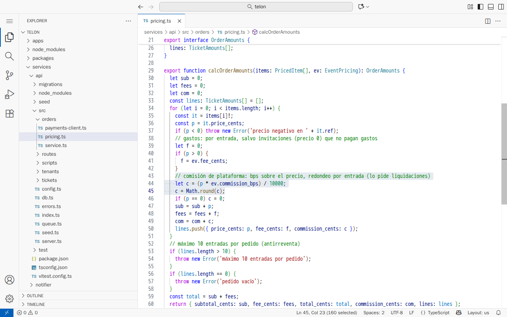
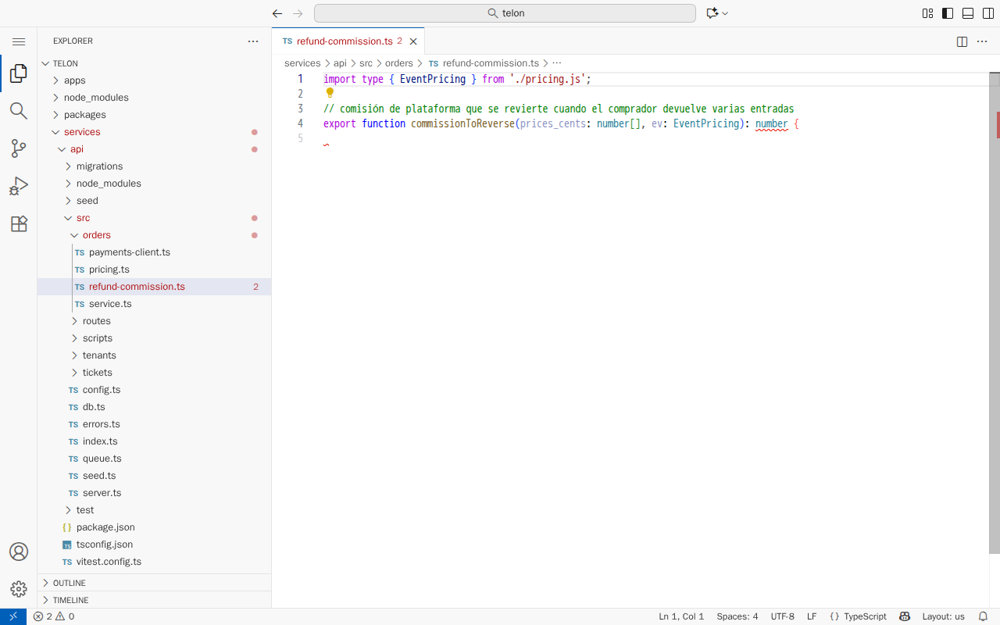
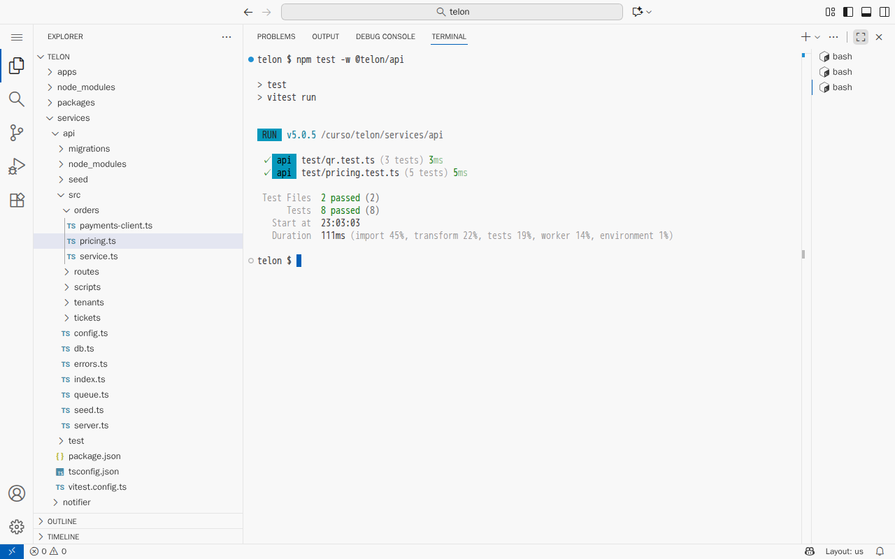

# Del autocompletado al agente

[← Página anterior](README.md) · [Siguiente página →](01-lab-entorno-y-primer-chat.md)

Autocompletado, chat y agente parecen la misma IA con distinta interfaz, pero no lo son: cada uno trabaja con una parte diferente del proyecto, y eso decide cuándo acierta y cómo se equivoca. En esta demostración se plantea a las tres formas de asistente el mismo problema del proyecto Telón: **cómo se calcula la comisión de las entradas**. La respuesta correcta está en el código, así que cada resultado se puede comparar con ella.

Todavía no hay nada que ayude al asistente: ni reglas del proyecto, ni `AGENTS.md`, ni instrucciones. Solo el código y lo que cada herramienta trae de serie. Lo que se ve es, por tanto, el comportamiento por defecto de cada forma de asistente.

## Punto de partida

- El repositorio del curso abierto en el Dev Container (VS Code local o Codespaces). El explorador de la izquierda muestra la carpeta `telon/`.
- GitHub Copilot activo: el icono de Copilot aparece en la barra de estado, abajo a la derecha. Con Copilot Free basta.
- Una terminal abierta en `telon/`: menú **Terminal → New Terminal**. El prompt termina en `telon $` o en `/telon$`.

### Qué herramienta hace cada paso

| Paso | Con GitHub Copilot (VS Code o Codespaces) | Con Cursor | Con Claude Code |
|------|-------------------------------------------|------------|-----------------|
| 1 · Autocompletado | Las sugerencias en gris del editor | Cursor Tab, las sugerencias en gris del editor | No tiene autocompletado: el paso 1 se hace con Copilot |
| 2 · Chat | Vista de chat (<kbd>Ctrl</kbd>+<kbd>Alt</kbd>+<kbd>I</kbd>), modo **Ask** | Chat (<kbd>Ctrl</kbd>+<kbd>L</kbd>), modo **Ask** | No tiene un chat que no lea el repositorio: el paso 2 se hace con Copilot o Cursor |
| 3 · Agente | Vista de chat, modo **Agent** | Chat, modo **Agent** | `claude` en la terminal, dentro de `telon/` |

### Preparación

**Paso A — Deja el proyecto en el estado de partida.**
En la terminal, escribe `CONFIRM=1 make init-m01` y pulsa <kbd>Enter</kbd>.
**Resultado esperado:** `telon/ está en el punto de partida de m01.`

**Paso B — Cierra todas las pestañas del editor.**
Pulsa <kbd>Ctrl</kbd>+<kbd>K</kbd> y, después, <kbd>W</kbd>.
**Resultado esperado:** el área del editor queda vacía.
**Por qué:** Copilot usa como contexto los ficheros abiertos. Si hay pestañas abiertas, el paso 1 y el 2 no salen limpios.

**Paso C — Localiza la respuesta correcta.**
1. Pulsa <kbd>Ctrl</kbd>+<kbd>P</kbd>, escribe `pricing.ts` y pulsa <kbd>Enter</kbd>.
2. Pulsa <kbd>Ctrl</kbd>+<kbd>G</kbd>, escribe `43` y pulsa <kbd>Enter</kbd>.

**Resultado esperado:** el cursor queda en la línea 43 de `services/api/src/orders/pricing.ts`, dentro de la función `calcOrderAmounts`.



Las líneas 43 a 45 son la regla:

```ts
// comisión de plataforma: bps sobre el precio, redondeo por entrada (lo pide liquidaciones)
let c = (p * ev.commission_bps) / 10000;
c = Math.round(c);
```

La comisión se calcula **por entrada**, como un porcentaje del precio de esa entrada (`commission_bps`; 750 equivale al 7,5 % de la Sala Faro), y se **redondea por entrada**. Con dos butacas de 35,50 € son 266 + 266 = **532 céntimos**. Si se calculara sobre el total, 7100 × 7,5 % = 532,5, saldrían **533**. Ese céntimo es lo que se busca en cada paso.

Cuando la tengas localizada, cierra la pestaña con <kbd>Ctrl</kbd>+<kbd>W</kbd>.

> [!NOTE]
> Las respuestas exactas cambian con el modelo que tenga activo cada herramienta y con su versión. Lo que se repite es el tipo de error, porque depende de lo que cada forma de asistente tiene delante. Si sale otra cosa, la pregunta es la misma: qué tenía delante para responder eso.

## Recorrido

### Paso 1 — El autocompletado completa lo más habitual

En `pricing.ts` el comentario de la línea 43 ya dice la regla, y el autocompletado la copiaría. La situación interesante es la de quien empieza código nuevo en otro fichero, donde esa regla no está a la vista.

**1.1 Crea un fichero nuevo.**
**Dónde:** en el explorador de la izquierda, carpeta `services` → `api` → `src` → `orders`.
**Qué haces:** clic derecho sobre `orders` → **New File…**, escribe `refund-commission.ts` y pulsa <kbd>Enter</kbd>.
**Resultado esperado:** se abre una pestaña vacía llamada `refund-commission.ts`, y el fichero aparece en el explorador junto a `pricing.ts`.

**1.2 Escribe la cabecera de la función.**
**Dónde:** en la pestaña `refund-commission.ts`.
**Qué haces:** escribe estas cuatro líneas a mano. Si mientras escribes aparece texto en gris, pulsa <kbd>Esc</kbd> para descartarlo; todavía no interesa.

```ts
import type { EventPricing } from './pricing.js';

// comisión de plataforma que se revierte cuando el comprador devuelve varias entradas
export function commissionToReverse(prices_cents: number[], ev: EventPricing): number {
```

**Resultado esperado:** las cuatro líneas en el editor. La llave de la línea 4 está subrayada en rojo porque la función aún no tiene cuerpo; es normal.



**1.3 Pide la sugerencia.**
**Qué haces:** con el cursor al final de la línea 4, pulsa <kbd>Enter</kbd> y espera dos o tres segundos sin escribir. Si no aparece nada, pulsa <kbd>Alt</kbd>+<kbd>\\</kbd> para pedirla.
**Resultado esperado:** aparece en gris el cuerpo de la función. Lo más habitual es que sume los precios y redondee una sola vez al final:

```ts
  const total = prices_cents.reduce((acc, p) => acc + p, 0);
  return Math.round((total * ev.commission_bps) / 10000);
```

No la aceptes. Pulsa <kbd>Alt</kbd>+<kbd>]</kbd> para ver otras sugerencias: casi todas calculan sobre el total.

**Por qué pasa:** el autocompletado no busca en el proyecto cómo se calcula la comisión. Ve el fichero abierto, unas pocas líneas alrededor del cursor y las pestañas abiertas, que ahora son ninguna. Con eso completa lo más probable en cualquier código parecido. Con F-12 y F-13 esa función devuelve 533, no 532. Es el mismo fallo que aparece en la devolución del M03.

**1.4 Repite con `pricing.ts` abierto.**
**Qué haces:**
1. Pulsa <kbd>Esc</kbd> para descartar la sugerencia.
2. Pulsa <kbd>Ctrl</kbd>+<kbd>P</kbd>, escribe `pricing.ts` y pulsa <kbd>Enter</kbd>. Se abre en otra pestaña.
3. Vuelve a la pestaña `refund-commission.ts`, deja el cursor en la línea 5, vacía, y pulsa <kbd>Alt</kbd>+<kbd>\\</kbd>.

**Resultado esperado:** a menudo la sugerencia cambia y redondea entrada a entrada, con el `Math.round` dentro del `reduce`.
**Por qué pasa:** Copilot añade al contexto las pestañas abiertas. Con `pricing.ts` delante, imita su regla; sin él, inventa. Si la sugerencia no cambia, la conclusión es la misma: lo que propone depende de lo que tiene alrededor, no de lo que es correcto.

**1.5 Deja el proyecto como estaba.**
**Qué haces:** cierra las dos pestañas sin guardar (<kbd>Ctrl</kbd>+<kbd>W</kbd> y **Don't Save**) y, en la terminal, escribe `rm services/api/src/orders/refund-commission.ts`.
**Resultado esperado:** `refund-commission.ts` desaparece del explorador.

### Paso 2 — El chat solo sabe lo que se le da

**2.1 Abre un chat sin ningún fichero.**
**Dónde:** vista de chat. En Copilot se abre con <kbd>Ctrl</kbd>+<kbd>Alt</kbd>+<kbd>I</kbd>; en Cursor, con <kbd>Ctrl</kbd>+<kbd>L</kbd>.
**Qué haces:**
1. Cierra todas las pestañas (<kbd>Ctrl</kbd>+<kbd>K</kbd> <kbd>W</kbd>).
2. Empieza una conversación nueva con el botón **+** de la parte superior de la vista de chat.
3. En el selector de modo, bajo la caja de texto, elige **Ask**.
4. Mira encima de la caja de texto: si aparece una etiqueta con el nombre de un fichero, haz clic en ella para quitarla.

**Resultado esperado:** una conversación vacía, en modo **Ask** y sin ningún fichero adjunto.

**2.2 Pregunta.**
**Qué haces:** escribe en el chat y pulsa <kbd>Enter</kbd>:

```text
En el proyecto, ¿cómo se calcula la comisión de plataforma de una entrada?
```

**Resultado esperado:** una respuesta segura y genérica, del tipo «un porcentaje configurable sobre el total del pedido, redondeado al final». A veces añade código de ejemplo que también calcula sobre el total. También puede contestar que necesita ver el código; eso ya es un acierto de esa herramienta, y la conclusión es la misma.
**Por qué pasa:** en modo **Ask**, sin ficheros adjuntos, el modelo no abre el repositorio. Contesta con lo que suele hacer una tienda de entradas, que es justo lo que aprendió en su entrenamiento. Se equivoca en los dos puntos importantes: el código calcula por entrada y redondea por entrada.

**2.3 Pregunta lo mismo con el fichero adjunto.**
**Qué haces:**
1. Empieza otra conversación nueva (**+**), en modo **Ask**.
2. Adjunta el fichero. En Copilot, escribe `#`, elige **Files & Folders** y después `pricing.ts`. En Cursor, escribe `@pricing.ts`.
3. Escribe la misma pregunta del paso 2.2 y pulsa <kbd>Enter</kbd>.

**Resultado esperado:** la regla correcta, por entrada y con redondeo por entrada. Suele citar el comentario de la línea 43 y el `Math.round` de la línea 45.
**Por qué pasa:** el modelo y la pregunta son los mismos. La respuesta cambia porque ahora tiene el código delante.

### Paso 3 — El agente busca la respuesta, ejecuta y propone cambios

**3.1 Abre el agente.**
**Dónde:** en Copilot o Cursor, conversación nueva (**+**) con el selector de modo en **Agent**. En Claude Code, escribe `claude` en la terminal, dentro de `telon/`.
**Resultado esperado:** una conversación vacía en modo agente.

**3.2 Pídele la explicación y la prueba.**
**Qué haces:** escribe y pulsa <kbd>Enter</kbd>:

```text
Explícame cómo se calcula la comisión de una entrada en el proyecto y compruébalo con un test.
```

**Resultado esperado:** el agente va contando lo que hace. Primero busca `commission` en el repositorio y después abre `services/api/src/orders/pricing.ts` y `services/api/test/pricing.test.ts`.

**3.3 Deja que ejecute los tests.**
**Qué haces:** cuando pida permiso para ejecutar `npm test -w @telon/api` (o algo parecido), acéptalo con **Continue** o **Run** en Copilot y Cursor, o con «Yes» en Claude Code.
**Resultado esperado:** el agente enseña la salida de los tests en verde y explica la regla correcta, con el fichero y las líneas. Es la misma salida que se obtiene al ejecutarlos a mano:



**3.4 Rechaza lo que no se ha pedido.**
**Qué haces:** si propone crear o modificar ficheros (lo habitual es un test nuevo o un retoque en `pricing.ts`), abre el diff, enséñalo y recházalo: **Undo** en Copilot, **Reject** en Cursor, «No» en Claude Code.
**Por qué pasa:** el agente acierta porque busca la respuesta en lugar de suponerla, y la comprueba ejecutando. Pero tiene permiso para escribir, y su instrucción por defecto es ser útil: si nadie le pone límites, hace más de lo que se le ha pedido.

**3.5 Deja el proyecto como estaba.**
**Qué haces:** en la terminal, `git status --short`. Si aparece algún fichero, `CONFIRM=1 make init-m01`.
**Resultado esperado:** `git status --short` no muestra nada.

## Qué queda visto

| Forma | Qué tiene delante | Cómo se equivoca en el proyecto |
|-------|-------------------|---------------------------------|
| Autocompletado | El fichero, el cursor y las pestañas abiertas | Calcula la comisión sobre el total: lo más habitual, no lo que hace el proyecto |
| Chat | Lo que se le pega o se le adjunta | Describe una comisión «sobre el total» sin haber leído el código |
| Agente | El repositorio, la terminal y los ficheros | Acierta y lo comprueba, pero cambia más de lo pedido si no se le pone límite |

La calidad de la respuesta depende de lo que el asistente tiene delante. Lo que no ve, lo rellena con lo más habitual. Por eso, en todo el curso, una respuesta se acepta cuando se ha comprobado en el código o con un test.

En [01 — Entorno y primer chat](01-lab-entorno-y-primer-chat.md) arrancas el proyecto y el asistente en tu puesto, y haces tu primera pregunta comprobada. Se puede hacer sin haber seguido esta demostración.
