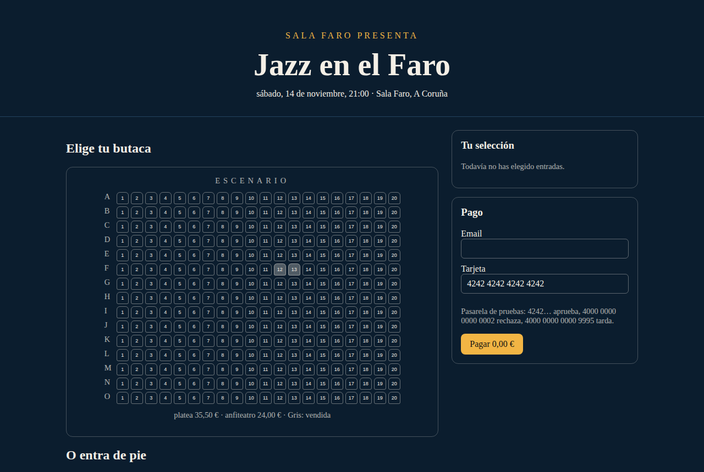
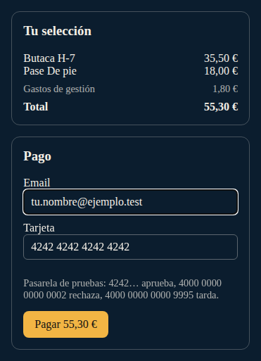
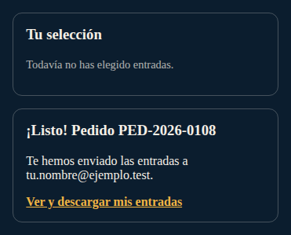
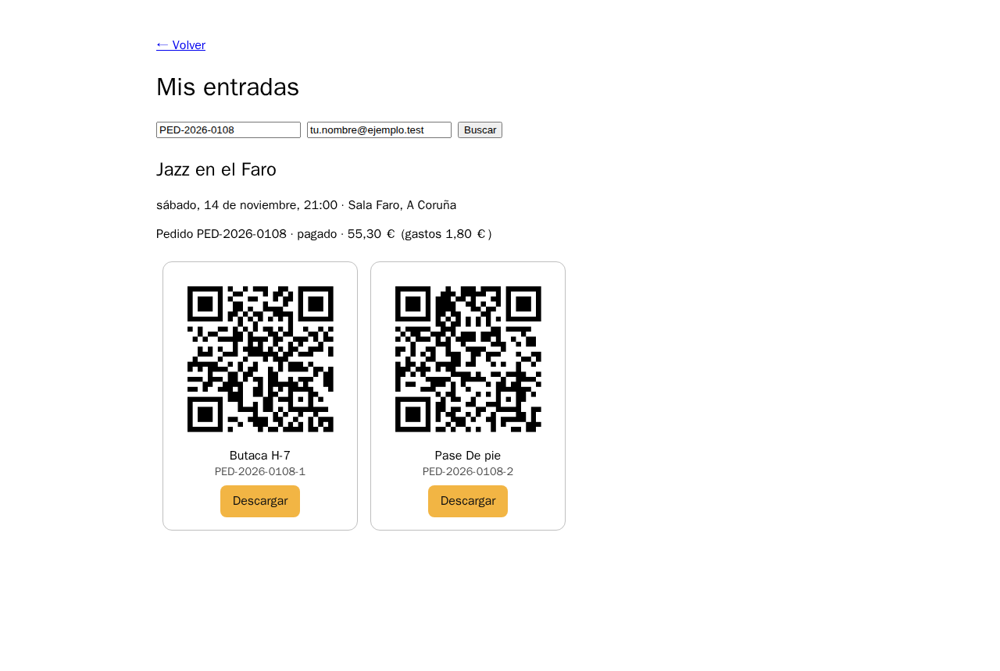
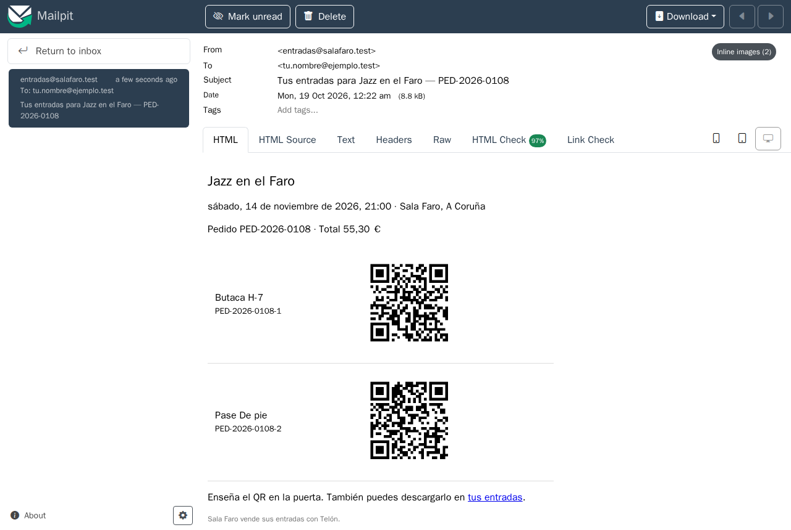
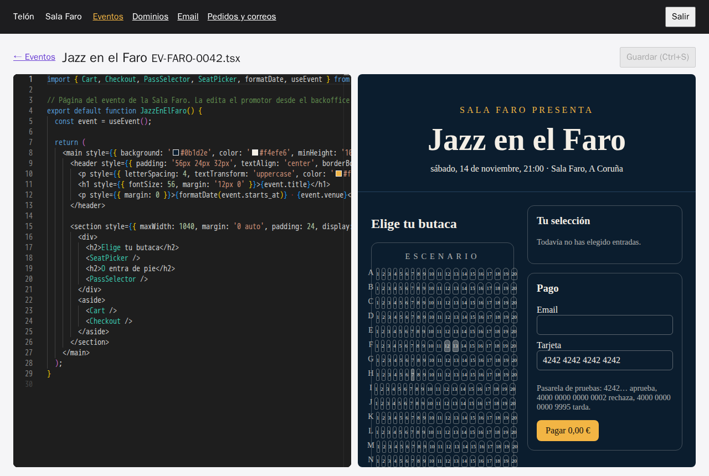
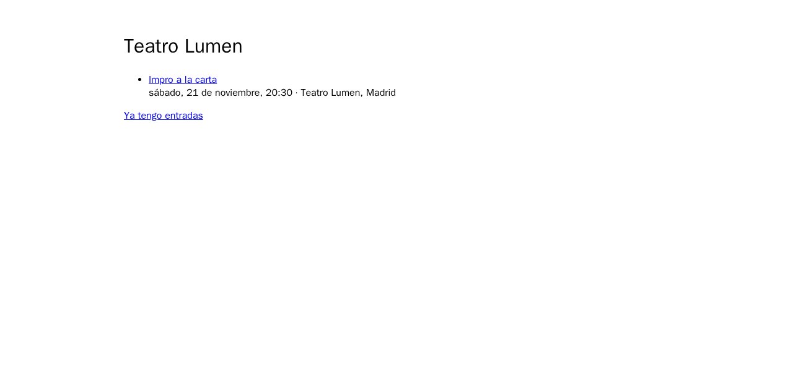
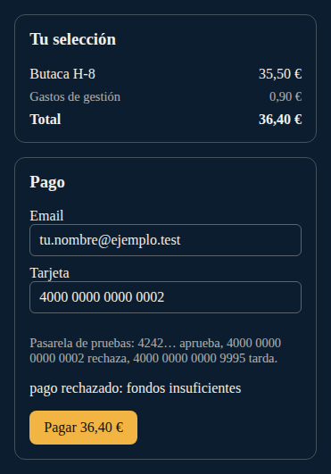
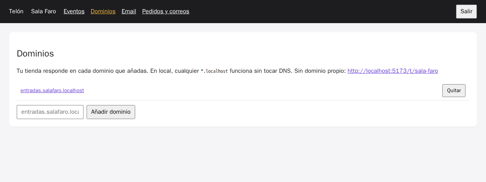

# Laboratorio: entorno y primer chat

[← Página anterior](00-del-autocompletado-al-agente.md) · [Siguiente página →](02-lab-leer-la-peticion.md)

Vas a trabajar sobre el proyecto Telón, el SaaS de entradas que hereda tu equipo. En este lab lo pones en marcha en tu puesto y compras una entrada de principio a fin, viendo llegar el correo con el QR. Después le haces la primera pregunta al asistente y compruebas su respuesta en el código.

### Objetivo

El proyecto arrancado en tu fork, una compra completa con su correo en Mailpit y el asistente respondiendo sobre el proyecto con afirmaciones comprobadas.

### Punto de partida

- Cuenta de GitHub y acceso al repositorio del curso.
- **Ruta local:** Git, Docker en marcha y Cursor o VS Code con la extensión *Dev Containers*. **Ruta Codespaces:** solo el navegador.
- Un asistente con licencia: Cursor, GitHub Copilot o Claude Code.
- Si ya tenías el repositorio de otro módulo, deja el proyecto en el estado de este lab desde la carpeta `telon/`: `make init-m01` (descarta cambios).

### En qué consiste

Fork, entorno (local o Codespaces), arranque, una compra de prueba, el correo en Mailpit, el editor del backoffice y una primera pregunta al asistente. No cambias código.

### 1 — Haz un fork del repositorio

**Acción:**
1. Abre el repositorio del curso en GitHub.
2. Pulsa **Fork**.
3. En **Owner**, elige tu usuario. Deja el nombre como está.
4. Pulsa **Create fork**.

**Por qué:** el curso es individual. En tu fork harás commits, ramas y pull requests sin pisar a nadie, y el asistente trabajará sobre tu copia.

**Resultado esperado:** estás en `github.com/<tu-usuario>/ia-developer-10x-201`, con el texto «forked from …» bajo el nombre.

### 2 — Abre el fork en el Dev Container

Elige una de las dos rutas.

**Acción (ruta local):**
1. En tu fork, pulsa **Code** y copia la URL HTTPS.
2. En una terminal: `git clone <url> && cd ia-developer-10x-201`
3. Abre la carpeta en Cursor o VS Code (`cursor .` o `code .`).
4. Cuando aparezca el aviso, pulsa **Reopen in Container**. Si no aparece: <kbd>Ctrl</kbd>+<kbd>Shift</kbd>+<kbd>P</kbd> → **Dev Containers: Reopen in Container**.

**Acción (ruta Codespaces):**
1. En tu fork, pulsa **Code** → pestaña **Codespaces** → **Create codespace on main**.

**Por qué:** el Dev Container trae Node 22, PostgreSQL, Redis y Mailpit ya configurados. Así todos tienen el mismo entorno, en local o en la nube, y no se pierde tiempo instalando dependencias.

**Resultado esperado:** el editor se abre en la carpeta `telon/` y la terminal muestra `npm install` terminando sin errores. La primera vez tarda más, porque descarga las imágenes y las dependencias.

> [!TIP]
> En Codespaces, el asistente integrado es GitHub Copilot. Claude Code también viene instalado: ejecuta `claude` en la terminal. Cursor no abre Codespaces directamente; para usarlo, sigue la ruta local.

### 3 — Arranca el proyecto

**Acción:** en la terminal:

```bash
make up-m01
```

**Por qué:** `make up-m01` arranca los seis procesos de la plataforma (API, pasarela, notifier, tienda, backoffice y editor) con los cambios que tengas. La primera vez, la API crea el esquema de la base de datos y carga los datos de ejemplo.

**Resultado esperado:** líneas con prefijos de colores: `[api] … Server listening at http://…:3000`, `[pagos] … :3001`, `[correo] notifier escuchando la cola «emails»` y tres `VITE … ready` (`[tienda]`, `[backoffice]`, `[editor]`). Deja esta terminal abierta y abre otra para lo demás.

### 4 — Abre la tienda de la Sala Faro

**Acción:**
- **Local:** abre `http://entradas.salafaro.localhost:5173` y pulsa **Jazz en el Faro**.
- **Codespaces:** abre la pestaña **Ports**, pulsa el globo de **Tienda (5173)** y añade `/t/sala-faro` a la URL. Pulsa **Jazz en el Faro**.

**Por qué:** El proyecto es multi-tenant. Cada promotor entra por su dominio (en local, cualquier `*.localhost` funciona sin tocar DNS) o, donde no hay dominios propios, por la ruta `/t/<slug>`. La página que ves es TSX escrito por el promotor y compilado en tu navegador.

**Resultado esperado:** la página oscura de «Jazz en el Faro» con el plano de butacas (F-12 y F-13 en gris, ya vendidas), los pases **De pie** y **VIP**, el carrito y el pago.



### 5 — Compra una butaca y un pase

**Acción:**
1. Pulsa la butaca **H-7** en el plano.
2. En **De pie**, pulsa **+** una vez.
3. En **Email**, escribe `tu.nombre@ejemplo.test`.
4. Deja la tarjeta `4242 4242 4242 4242` y pulsa **Pagar 55,30 €**.
5. Pulsa **Ver y descargar mis entradas**.



**Por qué:** es el recorrido completo de la plataforma. Pasa por el pedido en la API, el cobro en la pasarela emulada, la cola de correo y el notifier. Es el flujo que vas a tener que entender antes de tocar nada.

**Resultado esperado:** el bloque de pago cambia a «¡Listo! Pedido PED-2026-0108» (o el número siguiente) y la butaca H-7 pasa a gris. El total es 35,50 + 18,00 + 2 × 0,90 de gastos de gestión.



Desde **Ver y descargar mis entradas** llegas a «Mis entradas», con un QR por entrada y su botón **Descargar**.



### 6 — Mira el correo en Mailpit

**Acción:** abre Mailpit (local: `http://localhost:8025`; Codespaces: **Ports** → **Mailpit (8025)**) y pulsa el correo «Tus entradas para Jazz en el Faro».

**Por qué:** la Sala Faro tiene configurado SMTP, y en este entorno el SMTP es Mailpit, que recoge todo lo que se envía. Así compruebas que el correo sale de verdad, sin mandar nada a internet.

**Resultado esperado:** un correo para tu dirección con dos QR (butaca H-7 y pase De pie) y un enlace a «tus entradas».



### 7 — Abre el editor del backoffice

**Acción:**
1. Abre el backoffice (local: `http://localhost:5174`; Codespaces: **Ports** → **Backoffice (5174)**).
2. En **Entrar**, escribe el token `faro-dev-token` y pulsa **Entrar**.
3. En **Eventos**, pulsa **Editar página** en «Jazz en el Faro».

**Por qué:** así trabaja el promotor. El editor de la izquierda es Monaco (el de VS Code), servido como microfrontend dentro de un iframe. La vista previa de la derecha compila el TSX al vuelo con los componentes de `@telon/ui`.

**Resultado esperado:** el código de la página a la izquierda y la página renderizada a la derecha. Si cambias el texto `Elige tu butaca`, la vista previa cambia al momento y aparece «Cambios sin guardar». No guardes.



### 8 — Abre el asistente en modo agente

**Acción:** abre una conversación nueva en modo agente, según tu asistente:

| Asistente | Dónde está | Cómo dejarlo listo |
|-----------|------------|--------------------|
| VS Code o Codespaces + Copilot | Icono de chat de la barra superior, o <kbd>Ctrl</kbd>+<kbd>Alt</kbd>+<kbd>I</kbd>. Se abre a la derecha | Pulsa **+** (conversación nueva). Bajo la caja de texto, pon el selector de modo en **Agent** y deja el modelo que venga por defecto |
| Cursor | Panel de chat, <kbd>Ctrl</kbd>+<kbd>L</kbd>. Se abre a la derecha | Pulsa **+** (conversación nueva). Bajo la caja de texto, elige **Agent** |
| Claude Code | En una terminal nueva (**+** del panel de terminal) | Escribe `claude` y pulsa <kbd>Enter</kbd>. La primera vez te pide iniciar sesión: sigue el enlace que muestra |

**Por qué:** en el curso usas el modo agente, que lee ficheros, busca en el repositorio y ejecuta comandos. Es el que más ayuda y el que más hay que vigilar.

**Resultado esperado:** una caja de texto vacía, lista para escribir. En Copilot y Cursor se ve el modo **Agent** bajo la caja; en Claude Code, un recuadro con el cursor y la carpeta `telon` en la cabecera.

> [!NOTE]
> En este punto el proyecto no tiene ningún fichero de contexto para la IA (`AGENTS.md`, reglas, instrucciones). El asistente solo cuenta con el código y con lo que su herramienta trae de serie. Lo que responda es su comportamiento por defecto.

### 9 — Haz la primera pregunta

**Acción:** ve al chat, escribe esto y pulsa <kbd>Enter</kbd>:

```text
Lista las apps y servicios de este monorepo, qué hace cada uno y en qué puerto escucha.
Para cada puerto, dime en qué fichero lo has visto.
```

Si te pide permiso para leer ficheros o ejecutar comandos de búsqueda, acéptalo (**Continue**, **Run** o «Yes»).

**Por qué:** es una pregunta que se responde leyendo el repositorio. Pedir el fichero de cada dato obliga al asistente a decir de dónde lo saca, y te deja comprobarlo.

**Resultado esperado:** mientras trabaja, el asistente enseña qué lee: `package.json`, `README.md` y los ficheros de configuración de cada app y servicio. Después responde con una tabla de seis piezas:

| Pieza | Qué hace | Puerto |
|-------|----------|--------|
| `apps/storefront` | Tienda del comprador | 5173 |
| `apps/backoffice` | Panel del promotor | 5174 |
| `apps/editor-mfe` | Editor Monaco embebido en el backoffice | 5175 |
| `services/api` | API | 3000 u 8080 (ver paso 10) |
| `services/payments` | Pasarela de pago emulada | 3001 |
| `services/notifier` | Envío de correos desde la cola | sin puerto |

Lo que cambia según el modelo es el puerto de la API. Si el asistente leyó primero el `README.md`, dirá **8080** y citará el README. Si fue al código, dirá **3000** y citará `services/api/src/config.ts`. Las dos respuestas suenan igual de seguras.

### 10 — Comprueba el puerto de la API en el código

**Acción:**
1. Pulsa <kbd>Ctrl</kbd>+<kbd>P</kbd>, escribe `api/src/config.ts` y pulsa <kbd>Enter</kbd>.
2. Busca `port` con <kbd>Ctrl</kbd>+<kbd>F</kbd>.
3. En la terminal, escribe `curl -s localhost:3000/api/health`.

**Por qué:** el asistente mezcla lo que lee en el código con lo que lee en la documentación, y no avisa cuando se contradicen. El `README.md` dice 8080; el código, otra cosa. Esta es la costumbre del curso: cada afirmación se comprueba en el código o ejecutando.

**Resultado esperado:** en `config.ts`, el puerto por defecto de la API es `3000`, y `curl` responde `{"ok":true}`. Si el asistente dijo 8080, has encontrado tu primera afirmación falsa. Díselo en el mismo chat («El README dice 8080, pero config.ts dice 3000. ¿Cuál es el correcto y por qué?»): reconocerá el error y explicará que el README está desactualizado.

### 11 — Ejecuta los tests

**Acción:** en la terminal: `npm test`

**Por qué:** antes de tocar nada, sabes que el punto de partida está en verde. Si algo falla después, lo has roto tú (o el asistente).

**Resultado esperado:** `Tests  21 passed (21)`.

## Comprueba tu entendimiento

**El promotor por dominio y por ruta**
Abre `http://localhost:5173/t/teatro-lumen` (o la URL de la tienda en Codespaces con `/t/teatro-lumen`).
→ Ves la tienda del Teatro Lumen con «Impro a la carta». Es el mismo código que la Sala Faro con otro tenant.



**La pasarela rechaza**
Compra otra entrada con la tarjeta `4000 0000 0000 0002`.
→ Aparece «pago rechazado: fondos insuficientes», la butaca sigue libre y no llega ningún correo a Mailpit.



## Reto

### 1 — Que el asistente te enseñe a dar de alta un promotor

Quieres dar de alta un promotor nuevo con su propio dominio y no sabes cómo se hace en el proyecto. Sin abrir tú el código, escribe un prompt para que el asistente te dé los pasos exactos, con dónde está cada cosa en la interfaz, y después síguelos tal cual. El reto es el prompt: que las instrucciones que te devuelva funcionen a la primera.

<details>
<summary>Ver solución</summary>

Un prompt que funciona pide pasos ejecutables, el origen de cada dato y que no se cambie nada:

```text
Quiero dar de alta un promotor nuevo con su propio dominio y ver su tienda. Busca en el
código cómo se hace desde el backoffice. Dame los pasos numerados con el texto exacto de
cada botón y campo, las URLs que tengo que abrir y, para cada paso, el fichero donde lo has
visto. No cambies nada.
```

Lo habitual es que el asistente encuentre `apps/backoffice/src/Login.tsx` y `apps/backoffice/src/sections.tsx` y devuelva algo así: en `http://localhost:5174`, **Salir** si estás dentro; en **Crear cuenta de promotor**, nombre, slug y email (por ejemplo `Club Marea`, `club-marea`, `taquilla@clubmarea.test`) y **Crear cuenta**; **Entrar**; en **Dominios**, añadir `entradas.clubmarea.localhost`; abrir `http://entradas.clubmarea.localhost:5173`. Ves «Club Marea» sin eventos. En Codespaces, la tienda del promotor está en `/t/club-marea`.



Si algún paso no coincide con la pantalla (un botón con otro nombre, una URL que no carga), la instrucción vino de suponer y no de leer: pídele que te diga en qué línea lo ha visto. Un prompt sin «el texto exacto de cada botón» y sin «dónde lo has visto» suele devolver pasos genéricos de cualquier SaaS.

</details>

## Errores frecuentes

| Síntoma | Causa probable | Cómo arreglarlo |
|---------|----------------|-----------------|
| `entradas.salafaro.localhost` no carga | El navegador no resuelve `*.localhost` (algunas versiones de Safari) | Usa `http://localhost:5173/t/sala-faro` |
| `Port 5173 is already in use` | Otro proceso usa el puerto | Ciérralo o para el `make up-m01` anterior con <kbd>Ctrl</kbd>+<kbd>C</kbd> |
| `[api] … ECONNREFUSED 5432` | PostgreSQL no está arrancado (fuera del Dev Container) | `docker compose -f ../infra/compose.yaml up -d` desde `telon/` y repite |
| El pago se queda en «Pagando…» | Has usado la tarjeta lenta `…9995` | Espera 3 s: es a propósito |
| No llega el correo | El notifier no está arrancado o falló | Mira las líneas `[correo]` de la terminal de `make up-m01` |
