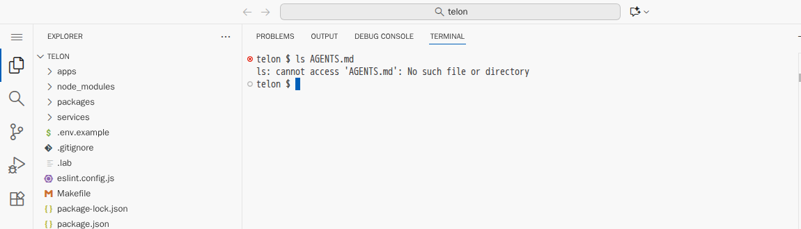
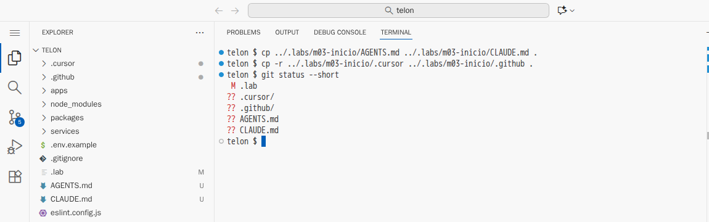
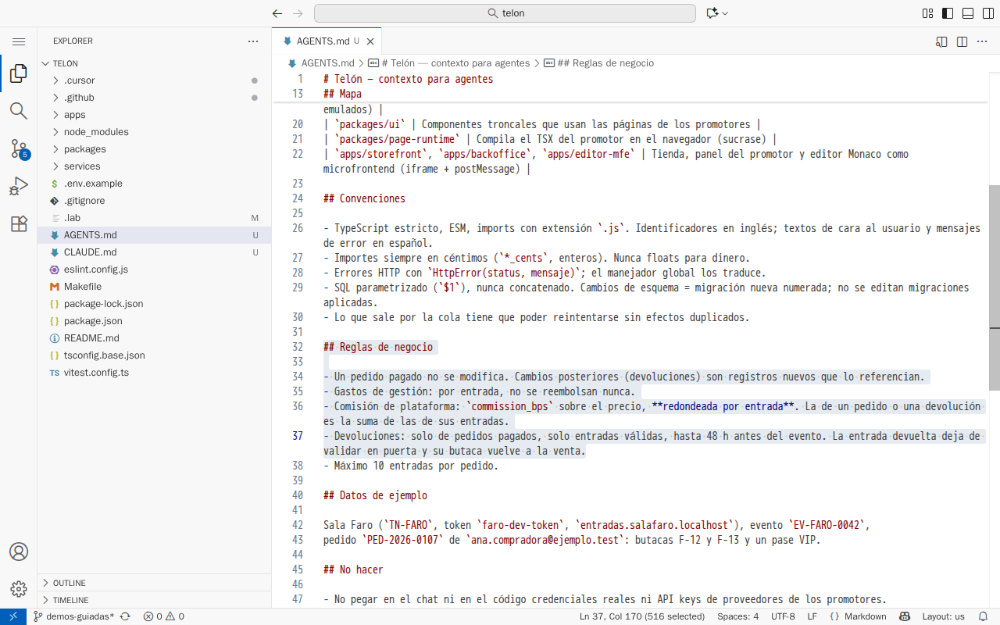
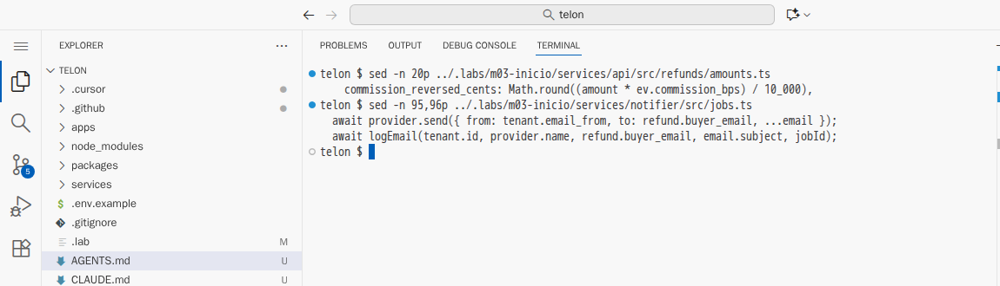

# El contexto cambia el diff

[← Página anterior](README.md) · [Siguiente página →](01-lab-reglas-del-proyecto.md)

Cuando un asistente genera código malo, la reacción habitual es reescribir el prompt. Esta demostración enseña que muchas veces el problema no está en el prompt, sino en lo que el asistente no sabe del negocio. Se pide dos veces la misma funcionalidad del proyecto Telón, la devolución de entradas (DEV-412), con el mismo prompt. La única diferencia es que la segunda vez las reglas del proyecto están escritas en el repositorio.

## Punto de partida

- El repositorio del curso abierto en el Dev Container (VS Code local o Codespaces), con una terminal abierta en `telon/` (**Terminal → New Terminal**).
- Un asistente en modo agente. En Copilot o Cursor, la vista de chat con el selector de modo en **Agent**. En Claude Code, `claude` en la terminal.

El prompt, idéntico en los dos intentos:

```text
Implementa DEV-412: el comprador puede devolver una o varias entradas de su pedido
desde "Mis entradas". Primero dame el plan y espera mi confirmación.
```

Las reglas de negocio que tiene que cumplir la devolución. Las conoce el equipo, pero no están en el código. Tenlas a la vista durante toda la demostración, porque cada plan se compara con ellas:

1. Un pedido pagado no se modifica: la devolución es un registro nuevo que lo referencia.
2. Los gastos de gestión no se reembolsan.
3. La comisión revertida es la suma de la de cada entrada, redondeada por entrada.
4. Solo se puede devolver hasta 48 h antes del evento.
5. El QR devuelto deja de valer y la butaca vuelve a la venta.
6. El correo sale por la cola y con el proveedor del promotor, una sola vez.

### Preparación

**Paso A — Deja el proyecto en el estado de partida.**
En la terminal, escribe `CONFIRM=1 make init-m02` y pulsa <kbd>Enter</kbd>.
**Resultado esperado:** `telon/ está en el punto de partida de m02.` Es el código heredado, sin reglas para la IA.

**Paso B — Comprueba que no hay contexto escrito.**
En la terminal, escribe `ls AGENTS.md` y pulsa <kbd>Enter</kbd>.
**Resultado esperado:** `ls: cannot access 'AGENTS.md': No such file or directory`.



**Por qué:** en el primer intento, el asistente solo tiene el código y lo que su herramienta trae de serie.

> [!NOTE]
> Lo que propone el asistente cambia con el modelo. Lo que se mantiene es qué reglas respeta cada intento y por qué.

## Recorrido

### Paso 1 — Sin contexto, el asistente aplica lo habitual

**1.1 Pide el plan.**
**Dónde:** conversación nueva en modo agente (botón **+** de la vista de chat, o `claude` en la terminal).
**Qué haces:** pega el prompt de arriba y pulsa <kbd>Enter</kbd>.
**Resultado esperado:** el agente explora el repositorio y lo va contando: abre `services/api/src/orders/`, `services/api/migrations/001_init.sql`, `services/payments` y `services/notifier`. Después devuelve un plan por escrito y se para.

> [!WARNING]
> Si empieza a escribir código a pesar de que el prompt le pide esperar, páralo (botón de detener de la vista de chat, o <kbd>Esc</kbd> en Claude Code) y rechaza los cambios (**Undo**, **Reject** o «No»).

**1.2 Contrasta el plan con las reglas.**
**Qué haces:** lee el plan punto por punto, en voz alta, y busca en él cada una de las seis reglas.
**Resultado esperado:** un plan razonable para cualquier tienda de entradas, y equivocado para esta. Lo habitual:

| Lo que propone | Regla que rompe | Consecuencia en el proyecto |
|----------------|-----------------|-----------------------------|
| Añadir `refunded` a `orders.status` y marcar el pedido entero | 1 | Un pedido pagado cambia, aunque solo se devuelva una entrada |
| Devolver `total_cents`, gastos incluidos | 2 | El promotor pierde los gastos de gestión |
| Borrar las filas de `tickets` «para liberar la butaca» | 5 | Liquidaciones pierde el rastro de esas entradas |
| Ningún límite de fecha | 4 | Se puede devolver una entrada con la función empezada |
| `transporter.sendMail` directo desde la API | 6 | El correo deja de usar el proveedor del promotor y la cola |

**Por qué pasa:** el asistente no se ha equivocado programando. Ha leído el código y ha rellenado con lo más común las reglas que nadie le dio, porque no están ni en el prompt ni en el repositorio. Cada modelo rellena a su manera, pero ninguno puede adivinar que en este negocio los gastos no se devuelven.

**1.3 Cierra la conversación.**
**Qué haces:** no contestes al plan. Cierra la conversación; en Claude Code, sal con `/exit`.
**Por qué:** el segundo intento tiene que empezar de cero, sin nada de este chat.

### Paso 2 — Con las reglas en el repositorio, el plan cambia sin tocar el prompt

**2.1 Copia las reglas del proyecto.**
**Dónde:** en la terminal, en `telon/`.
**Qué haces:** escribe estos comandos:

```bash
cp ../.labs/m03-inicio/AGENTS.md ../.labs/m03-inicio/CLAUDE.md .
cp -r ../.labs/m03-inicio/.cursor ../.labs/m03-inicio/.github .
git status --short
```

**Resultado esperado:** `git status` muestra cuatro entradas nuevas, marcadas con `??`: `.cursor/`, `.github/`, `AGENTS.md` y `CLAUDE.md`. La línea `M .lab` es el marcador del estado del lab y no tiene que ver con las reglas.



**2.2 Enseña qué se ha copiado.**
**Qué haces:** pulsa <kbd>Ctrl</kbd>+<kbd>P</kbd>, escribe `AGENTS.md` y pulsa <kbd>Enter</kbd>. Baja hasta la sección **Reglas de negocio**, en la línea 32.
**Resultado esperado:** las mismas reglas de la lista de arriba, escritas para el asistente.



`CLAUDE.md`, `.cursor/rules/telon.mdc` y `.github/copilot-instructions.md` solo apuntan a `AGENTS.md`. Cada herramienta lee su fichero al empezar una conversación, así que las tres acaban leyendo las mismas reglas.

**2.3 Pide el plan otra vez, en una conversación nueva.**
**Dónde:** conversación **nueva** en modo agente.
**Qué haces:** pega exactamente el mismo prompt y pulsa <kbd>Enter</kbd>.
**Resultado esperado:** otro plan, que cita `AGENTS.md` al justificar sus decisiones. Lo habitual:

- tablas nuevas `refunds` y `refund_tickets` en una migración `002_…`, sin tocar la `001` (regla 1);
- importe = suma de los precios de las entradas, sin gastos (regla 2);
- comprobación de las 48 h antes del evento (regla 4);
- un estado nuevo de entrada, `refunded`, que libera la butaca porque el índice único solo mira `pending` y `valid` (regla 5);
- devolución en la pasarela con `POST /refunds` y un trabajo `refund-confirmed` en la cola `emails` (regla 6).

En Copilot y Cursor, la lista de referencias de la respuesta incluye `AGENTS.md` o el fichero de instrucciones. En Claude Code, `CLAUDE.md` se carga al arrancar.

**Por qué pasa:** el prompt no ha cambiado ni una palabra. Lo que ha cambiado es el repositorio: la herramienta añade las reglas a la conversación sin que nadie las pegue. Por eso cualquier chat y cualquier persona del equipo obtiene el mismo punto de partida.

**2.4 Para ahí.**
**Qué haces:** no le confirmes el plan. Para ver la diferencia no hace falta que implemente nada.

### Paso 3 — El contexto mejora el plan, pero no lo verifica

Con estas mismas reglas, la devolución del curso se generó entera. Ese resultado es el punto de partida del M03 y está en `../.labs/m03-inicio/`.

**3.1 Enseña dos líneas del resultado.**
**Dónde:** en la terminal, en `telon/`.
**Qué haces:**

```bash
sed -n 20p ../.labs/m03-inicio/services/api/src/refunds/amounts.ts
sed -n 95,96p ../.labs/m03-inicio/services/notifier/src/jobs.ts
```

**Resultado esperado:**



- La primera línea calcula la comisión revertida sobre el total de las entradas devueltas, no por entrada (regla 3). Con F-12 y F-13 revierte 533 céntimos en lugar de 532.
- Las dos siguientes envían el correo y después lo registran. Si el registro falla, la cola reintenta el trabajo y el correo sale otra vez (regla 6).

**Por qué pasa:** las dos reglas están escritas en `AGENTS.md` y aun así el código generado no las cumple. El asistente las aplicó en el plan, donde son frases, pero no en el detalle del código, donde son un redondeo y el orden de dos líneas. Y los tests que generó con ese código están en verde. Encontrar estos dos fallos es el trabajo del M03.

**3.2 Deja el proyecto como estaba.**
**Qué haces:** en la terminal, `CONFIRM=1 make init-m02`.
**Resultado esperado:** `ls AGENTS.md` vuelve a responder `No such file or directory`.

## Qué queda visto

| Pieza | Sin contexto | Con `AGENTS.md` |
|-------|--------------|-----------------|
| Pedido original | Se modifica | Intacto; la devolución lo referencia |
| Importe | Total con gastos | Precio de las entradas |
| Butaca | Se borra la entrada | Estado `refunded`; vuelve a la venta |
| Plazo | Ninguno | 48 h antes del evento |
| Correo | Directo desde la API | Cola `emails`, proveedor del promotor |
| Comisión revertida | — | Sobre el total: sigue mal |

Lo que cambia el diff no es un prompt más largo, sino que las reglas del negocio estén escritas en el repositorio. Y lo que no cubren las reglas lo tienen que encontrar la revisión y los tests.

En [01 — Reglas del proyecto](01-lab-reglas-del-proyecto.md) escribes ese `AGENTS.md` con el asistente. Se puede hacer sin haber seguido esta demostración.
