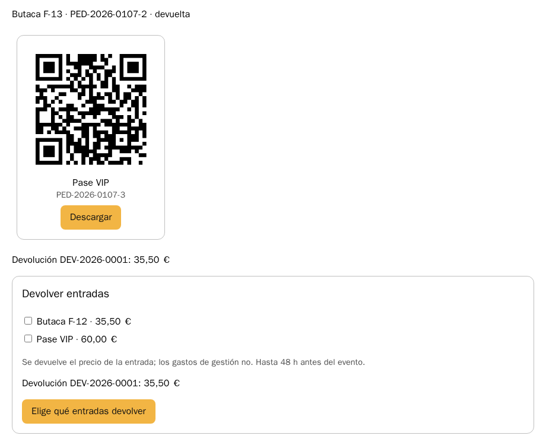

# Laboratorio: generar la devolución

[← Página anterior](01-lab-reglas-del-proyecto.md) · [Siguiente página →](03-lab-explicar-y-refactorizar.md)

Con las reglas del proyecto en el repositorio, le pides al asistente la devolución de entradas (DEV-412): base de datos, API, pasarela, correo y el componente del comprador. No la aceptas en bloque. Pides primero el plan, después cada parte por separado, y revisas cada diff antes de seguir.

### Objetivo

La devolución funcionando de punta a punta: la compradora de `PED-2026-0107` devuelve la butaca F-13 desde «Mis entradas», recibe el correo y el QR deja de valer. Todo con diffs que has revisado.

### Punto de partida

- Telón abierto en el Dev Container, carpeta `telon/`.
- Estado: `make init-m02` y las reglas del proyecto de referencia (si ya tienes las tuyas del lab anterior, usa las tuyas):

```bash
cp ../.labs/m03-inicio/AGENTS.md ../.labs/m03-inicio/CLAUDE.md .
cp -r ../.labs/m03-inicio/.cursor ../.labs/m03-inicio/.github .
```

- `make up-m02` arrancado en otra terminal, y Mailpit abierto.
- El pedido de referencia: `PED-2026-0107` de `ana.compradora@ejemplo.test`, con las butacas F-12 y F-13 y un pase VIP.

### En qué consiste

Cuatro entregas pequeñas en lugar de una grande: plan, API, correo y componente. Revisas cada una antes de pasar a la siguiente. Al final pruebas en la tienda y en Mailpit.

### 1 — Crea una rama

**Acción:** `git switch -c feat/dev-412-devoluciones`

**Por qué:** el cambio llegará a `main` por pull request en el M05. Trabajar en una rama te deja descartar un intento del asistente sin perder nada.

**Resultado esperado:** `Switched to a new branch 'feat/dev-412-devoluciones'`.

### 2 — Pide el plan con las cuatro piezas

**Acción:** en un chat nuevo:

```text
DEV-412. Intención: que el comprador devuelva una o varias entradas de un pedido pagado
desde "Mis entradas".
Restricciones: las de AGENTS.md (pedido inmutable, sin gastos de gestión, comisión por
entrada, 48 h, QR revocado, correo una sola vez por la cola). La pasarela ya tiene POST /refunds.
Ejemplo: devolver la butaca F-13 de PED-2026-0107 (ana.compradora@ejemplo.test) devuelve
35,50 € y revierte 2,66 € de comisión; F-13 vuelve a estar libre.
Hecho cuando: npm test, lint y typecheck en verde, y el ejemplo funciona en la tienda.
Dame solo el plan: ficheros que crearías o cambiarías y por qué. Espera mi confirmación.
```

**Por qué:** intención, restricciones, ejemplo y criterio de hecho son las cuatro piezas que cambian el diff. Pedir el plan antes que el código te deja corregir el rumbo cuando es barato.

**Resultado esperado:** un plan con, más o menos, una migración `002_refunds.sql` (tablas `refunds` y `refund_tickets`), un módulo `services/api/src/refunds/`, una ruta `POST /api/public/orders/:id/refunds`, `refund()` en `payments-client.ts`, un trabajo `refund-confirmed` en la cola y el notifier, y un componente en `packages/ui` usado en «Mis entradas».

### 3 — Corrige el plan antes de que escriba código

**Acción:** revisa el plan contra esta lista y contesta con las correcciones que hagan falta:
- ¿Toca `001_init.sql` o crea una migración nueva? Tiene que ser nueva.
- ¿Cambia `orders.status`? No debe.
- ¿Devuelve `total_cents`? Debe devolver la suma de `price_cents` de las entradas.
- ¿Envía el correo desde la API? Debe encolarlo.
- ¿Añade dependencias? No hacen falta.

**Por qué:** corregir un plan cuesta una frase. Corregir el mismo error en cinco ficheros cuesta una tarde.

**Resultado esperado:** un plan que respeta las cinco condiciones y tu «adelante, empieza por la API».

### 4 — Genera la parte de la API

**Acción:**

```text
Implementa solo la parte de la API: migración, módulo refunds, ruta y refund() en
payments-client. No toques notifier ni packages/ui todavía. Añade tests de la lógica de
importes y del plazo de 48 h.
```

**Por qué:** un diff acotado se puede revisar entero. Si mezcla API, worker y React, acabarás aprobando partes que no has leído.

**Resultado esperado:** cambios solo en `services/api/` y tests nuevos en `services/api/test/`.

### 5 — Revisa el diff de la API

**Acción:** abre el diff (`git diff` o la vista de cambios del editor) y repasa:

| Mira | Señal de alarma |
|------|-----------------|
| Imports | Un paquete que no está en `package.json` |
| Migración | Cambios en `001_init.sql` |
| SQL | Texto concatenado con `+` o `${}` dentro de la consulta |
| Dinero | `parseFloat`, `/ 100` en la API o importes en euros |
| Errores | `throw new Error` donde el cliente debería ver un 4xx (`HttpError`) |
| Tests | Tests existentes modificados para que pasen |
| Comisión | Calculada sobre el total en lugar de sumar la de cada entrada |

**Por qué:** son los fallos típicos de un diff generado. El último es el que más se cuela, porque el resultado parece correcto con una sola entrada.

**Resultado esperado:** cada punto revisado y corregido. Si la comisión se calcula sobre el total, apúntalo: en el M03 verás cómo lo detecta un test.

### 6 — Pasa las comprobaciones

**Acción:** `npm test && npm run lint && npm run typecheck`

**Por qué:** es el criterio de hecho que diste. Si algo falla, pégale al asistente la salida completa y pide la causa antes que el arreglo.

**Resultado esperado:** todo en verde, con más tests que los 21 del punto de partida.

### 7 — Genera el correo de confirmación

**Acción:**

```text
Ahora el notifier: trabajo refund-confirmed con la devolución, las entradas devueltas y el
importe. Usa el mismo proveedor del promotor que order-confirmed. Solo services/notifier y
el tipo del trabajo en services/api/src/queue.ts.
```

Revisa el diff con la regla «lo que sale por la cola tiene que poder reintentarse sin efectos duplicados».

**Por qué:** el worker reintenta hasta 3 veces cuando algo falla. Si el correo se envía antes de algo que puede fallar, la compradora recibe el correo varias veces.

**Resultado esperado:** `sendRefundConfirmed` en `services/notifier/src/jobs.ts`, una plantilla en `templates.ts` y el caso nuevo en `handle`.

### 8 — Genera el componente del comprador

**Acción:**

```text
Ahora packages/ui: componente RefundRequest que lista las entradas válidas del pedido con
casillas y un botón "Devolver X €". Úsalo en "Mis entradas" de apps/storefront. Sigue el
estilo de los componentes existentes (styles.ts, sin dependencias nuevas).
```

**Por qué:** «Mis entradas» es la pantalla donde el comprador ya ve sus QR. El componente usa el mismo cliente de la API y los mismos estilos que los demás, así que heredará el tema de cada promotor.

**Resultado esperado:** `packages/ui/src/RefundRequest.tsx`, exportado en `index.ts`, y usado en `apps/storefront/src/pages.tsx`.

### 9 — Prueba el ejemplo en la tienda

**Acción:**
1. Abre `http://entradas.salafaro.localhost:5173/mis-entradas?pedido=PED-2026-0107&email=ana.compradora@ejemplo.test` (en Codespaces: URL de la tienda + `/t/sala-faro/mis-entradas?pedido=PED-2026-0107&email=ana.compradora@ejemplo.test`).
2. Marca **Butaca F-13** y pulsa **Devolver 35,50 €**.
3. Abre Mailpit.

**Por qué:** es el ejemplo que diste como criterio de hecho. Los tests prueban la lógica; esto prueba que las piezas están conectadas.

**Resultado esperado:** «Devolución DEV-2026-0001: 35,50 €». El QR de F-13 desaparece y en Mailpit hay un correo de confirmación de la devolución. En la página del evento, F-13 vuelve a estar libre.



### 10 — Comprueba que el QR ya no entra

**Acción:**

```bash
TOKEN=$(npm run -s qr -- PED-2026-0107-2)
curl -s localhost:3000/api/tickets/validate -H 'content-type: application/json' -d "{\"token\":\"$TOKEN\"}"
```

`npm run qr` imprime el contenido del QR de cualquier entrada, como si lo leyera el lector de la puerta.

**Por qué:** es la regla que más importa en la puerta. Una entrada devuelta que sigue entrando le cuesta dinero al promotor.

**Resultado esperado:** `{"ok":false,"reason":"entrada refunded"}` o un texto equivalente: lo importante es `ok: false`. Con `PED-2026-0107-3` (el VIP, no devuelto) sale `ok: true`.

### 11 — Haz commit

**Acción:** `git add -A && git commit -m "DEV-412: devolución de entradas"`

**Por qué:** el cambio queda guardado en tu rama para revisarlo en el M05.

**Resultado esperado:** un commit en `feat/dev-412-devoluciones`.

> [!NOTE]
> La implementación de referencia del curso está en `../.labs/m03-inicio/`: es el punto de partida del M03. Lleva dos fallos a propósito que este lab no detecta.

## Comprueba tu entendimiento

**Fuera de plazo**
Pide al asistente un test que devuelva una entrada de un evento que empieza dentro de 24 h, y ejecútalo.
→ La API responde 409 con el mensaje del plazo de 48 h.

**Dos entradas**
Devuelve F-12 y F-13 juntas por `curl` (`POST /api/public/orders/PED-2026-0107/refunds` con la cabecera `x-telon-tenant-slug: sala-faro`) después de `npm run db:reset`.
→ `amount_cents: 7100`. Mira `commission_reversed_cents`: debería ser 532 (266 + 266). Si sale 533, se calcula sobre el total.

## Reto

### 1 — El promotor también quiere verlo

Pide al asistente que las devoluciones aparezcan en **Pedidos y correos** del backoffice, con el menor diff posible.

<details>
<summary>Ver solución</summary>

Basta con un endpoint de solo lectura en `services/api/src/routes/admin.ts` (`GET /api/admin/refunds`, filtrando por `tenant_id`, igual que `GET /api/admin/orders`) y una tabla más en `Orders()` de `apps/backoffice/src/sections.tsx` con `useAdmin('/refunds')`. Si el asistente propone tocar el modelo o la tienda, el diff es más grande de lo que hace falta.

</details>

## Errores frecuentes

| Síntoma | Causa probable | Cómo arreglarlo |
|---------|----------------|-----------------|
| `relation "refunds" does not exist` | La API no ha aplicado la migración nueva | Reinicia `make up-m02` (la API migra al arrancar) |
| `la pasarela no ha podido hacer la devolución (HTTP 404)` | La pasarela no conoce el cargo | `npm run db:reset` con todo arrancado: deja base de datos y pasarela coherentes |
| El correo llega dos o tres veces | El notifier envía antes de un paso que falla y la cola reintenta | Es el fallo que se trabaja en el M03; mira las líneas `[correo]` |
| El asistente cambió 20 ficheros | Prompt sin acotar | `git checkout .` y repite el paso con «solo …» |
