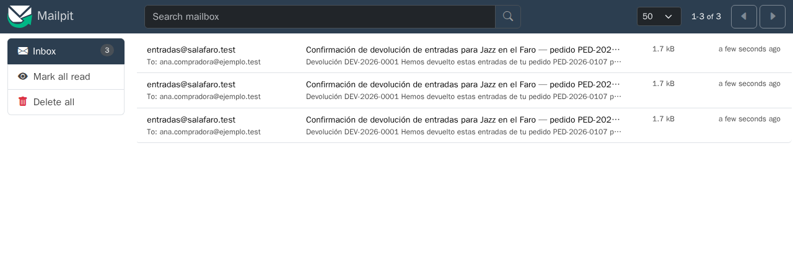

# La red de tests

[← Página anterior](README.md) · [Siguiente página →](01-lab-tests-y-datos.md)

Pedirle tests al asistente es fácil y rápido, y casi siempre salen en verde. La cuestión es si esos tests protegen de algo. En el proyecto Telón, la devolución de entradas ya está implementada y tiene sus tests en verde, pero esconde un céntimo de más en la comisión. Esta demostración pide más tests de dos maneras, a partir del código y a partir de la regla de negocio, y mira cuál de las dos lo encuentra.

## Punto de partida

- Repositorio del curso abierto en el Dev Container (local o Codespaces), con dos terminales en `telon/`.
- Un asistente en modo agente: Copilot o Cursor en modo **Agent**, o Claude Code (`claude` en la terminal, desde `telon/`).
- El caso que se usa para comparar: Ana devuelve las butacas F-12 y F-13 del pedido `PED-2026-0107`, de 35,50 € cada una, con una comisión del 7,5 % (`commission_bps: 750`).
- El valor correcto, calculado a mano con la regla de `AGENTS.md` («la comisión revertida es la suma de la de cada entrada, redondeada por entrada»): 3550 × 7,5 % = 266,25, que se redondea a 266 por butaca, **532 céntimos** en total. Calculada sobre el total (7100 × 7,5 % = 532,5) saldría **533**.

### Preparación

1. Terminal 1: `CONFIRM=1 make init-m03`. Deja la devolución implementada (`services/api/src/refunds/`) y `AGENTS.md` con las reglas.
2. Terminal 1: `npm test`. Termina con `Tests  26 passed (26)`: este es el verde de partida.
3. Terminal 2: `make up-m03`, y se deja abierta. Hace falta para el paso 3.
4. Se abre `services/api/src/refunds/amounts.ts` y se enseña la línea 20:

```ts
commission_reversed_cents: Math.round((amount * ev.commission_bps) / 10_000),
```

Ahí está el fallo: suma los precios y redondea una sola vez. De momento no se comenta: se trata de ver si los tests lo encuentran.

> [!NOTE]
> El número exacto de tests generados cambia con el modelo. Lo que se repite es de dónde sale el valor esperado de cada test.

## Recorrido

### 1. Tests a partir del código: confirman lo que hay

1. Se abre una conversación nueva en modo agente y se pide:

```text
Genera tests completos para services/api/src/refunds/amounts.ts.
```

2. El agente lee `amounts.ts`, escribe un fichero de tests (normalmente en `services/api/test/`) y pide permiso para ejecutarlos. Se le permite.
3. Si entre los casos no está el de dos butacas, se le pide: `Añade el caso de devolver F-12 y F-13: dos entradas de 3550 con commission_bps 750.`
4. Se busca en el test generado el valor que espera para ese caso (<kbd>Ctrl</kbd>+<kbd>F</kbd> → `533`).

**Qué se ve:** el test espera `533` para F-12 y F-13 y está en verde, como todos los demás. A menudo el comentario del test explica el cálculo copiando la línea 20: `Math.round(7100 × 0,075)`.

**Qué muestra:** el valor esperado ha salido del propio código. Si el código está mal, el test está mal de la misma forma, y por eso pasa: el test comprueba que el código hace lo que hace.

5. Para empezar el paso 2 desde cero: se cierra la conversación y, en la terminal 1, `CONFIRM=1 make init-m03`. Borra el test generado y deja el código como al principio; `make up-m03` se reinicia solo en la terminal 2.

### 2. Tests a partir de la regla: comprueban lo que debería hacer

1. Se abre una conversación **nueva** y se pide:

```text
Genera tests para la devolución a partir de las reglas de negocio de AGENTS.md, no del
código. Calcula los valores esperados a mano a partir de la regla y explícalos en un comentario.
```

2. El agente lee la sección **Reglas de negocio** de `AGENTS.md`, escribe los tests con el cálculo en un comentario y los ejecuta.

**Qué se ve:** un test que parte de la regla, 266 + 266 = 532, y sale en rojo:

```text
AssertionError: expected 533 to be 532
```

Es habitual que el agente proponga enseguida «arreglar» algo. Se le para, y se rechaza sobre todo si quiere cambiar el `532` del test por `533`.

**Qué muestra:** el código calcula sobre el total de las entradas, no por entrada. Con una sola entrada los dos cálculos dan lo mismo, y por eso los 26 tests de partida no lo vieron. Con dos butacas de 35,50 €, el redondeo se separa un céntimo.

3. Para dejarlo como estaba: `CONFIRM=1 make init-m03` en la terminal 1.

### 3. Lo que ningún test unitario ve

Con los mismos 26 tests en verde hay otro fallo. Se reproduce con `make up-m03` arrancado en la terminal 2:

1. Terminal 1: `npm run db:reset`.
2. Se abre Mailpit (local: `http://localhost:8025`; Codespaces: **Ports** → **Mailpit (8025)**) y se pulsa **Delete all**.
3. Terminal 1, la devolución de F-12 y F-13:

```bash
curl -s localhost:3000/api/public/orders/PED-2026-0107/refunds \
  -H 'x-telon-tenant-slug: sala-faro' -H 'content-type: application/json' \
  -d '{"email":"ana.compradora@ejemplo.test","ticket_ids":["PED-2026-0107-1","PED-2026-0107-2"]}'
```

4. Se esperan unos diez segundos y se refresca Mailpit.

**Qué se ve:** tres correos iguales de confirmación de la devolución para Ana.



En la terminal 2, las líneas `[correo]` muestran el motivo: `refund-confirmed` falla tres veces con `value too long for type character varying(80)`.

**Qué muestra:** ningún test unitario lo detecta, porque el fallo aparece en la combinación de notifier, base de datos y cola. El correo se envía, el registro del envío falla porque el asunto es demasiado largo para la columna, y la cola reintenta. Cada intento manda el correo otra vez.

## Qué queda visto

| Tests que propone el asistente | Tests que hacen falta |
|--------------------------------|-----------------------|
| Esperan lo que devuelve el código | Esperan lo que dice la regla, calculado a mano |
| Usan una sola entrada, donde el redondeo no se nota | Usan dos entradas cuyo redondeo por entrada difiere del total |
| Comprueban que se llama a `send` | Comprueban que, si el trabajo se reintenta, el correo sale una vez |

Unos tests en verde solo dicen que el test y el código están de acuerdo. Para que encuentren fallos, el valor esperado tiene que salir de la regla de negocio, no del código que se quiere probar.

En [01 — Tests y datos](01-lab-tests-y-datos.md) generas la batería a partir de las reglas, y en [04 — El correo que llegaba tres veces](04-lab-debugging-correo-duplicado.md) depuras el correo duplicado. Los dos se pueden hacer sin haber seguido esta demostración.
