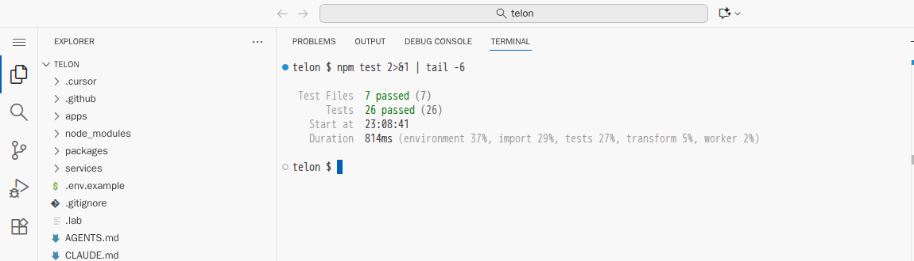
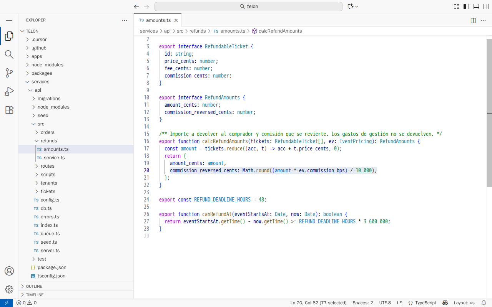
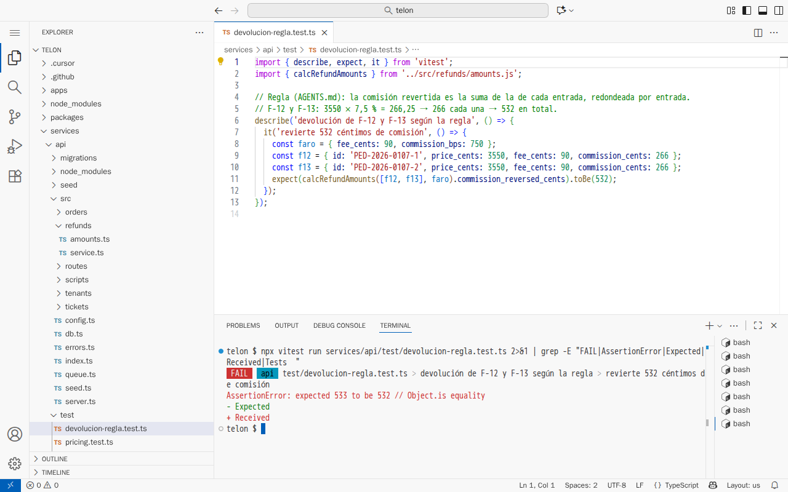

# La red de tests

[← Página anterior](README.md) · [Siguiente página →](01-lab-tests-y-datos.md)

Pedirle tests al asistente es fácil y rápido, y casi siempre salen en verde. La cuestión es si esos tests protegen de algo. En el proyecto Telón, la devolución de entradas ya está implementada y tiene sus tests en verde, pero esconde un céntimo de más en la comisión. Esta demostración pide más tests de dos maneras, a partir del código y a partir de la regla de negocio, y mira cuál de las dos encuentra el fallo.

## Punto de partida

- El repositorio del curso abierto en el Dev Container (VS Code local o Codespaces), con **dos** terminales abiertas en `telon/`. Para la segunda, pulsa el **+** del panel de terminal.
- Un asistente en modo agente. En Copilot o Cursor, la vista de chat con el selector de modo en **Agent**. En Claude Code, `claude` en la terminal.
- El caso que se usa para comparar: Ana devuelve las butacas F-12 y F-13 del pedido `PED-2026-0107`, de 35,50 € cada una, con una comisión del 7,5 % (`commission_bps: 750`).
- El valor correcto, calculado a mano con la regla de `AGENTS.md` («la comisión revertida es la suma de la de cada entrada, redondeada por entrada»): 3550 × 7,5 % = 266,25, que se redondea a 266 por butaca, **532 céntimos** en total. Calculada sobre el total, 7100 × 7,5 % = 532,5, saldrían **533**.

### Preparación

**Paso A — Deja el proyecto en el estado de partida.**
En la terminal 1, escribe `CONFIRM=1 make init-m03`.
**Resultado esperado:** `telon/ está en el punto de partida de m03.` La devolución está implementada en `services/api/src/refunds/`, y `AGENTS.md` tiene las reglas.

**Paso B — Ejecuta los tests de partida.**
En la terminal 1, escribe `npm test`.
**Resultado esperado:** la salida termina con `Tests  26 passed (26)`. Este es el verde de partida.



**Paso C — Arranca la plataforma.**
En la terminal 2, escribe `make up-m03` y déjala abierta. Hace falta en el paso 3.
**Resultado esperado:** líneas de `[api]`, `[pagos]`, `[correo]`, `[tienda]`, `[backoffice]` y `[editor]`, y ningún error.

**Paso D — Enseña dónde está el fallo, sin explicarlo.**
Pulsa <kbd>Ctrl</kbd>+<kbd>P</kbd>, escribe `refunds/amounts.ts` y pulsa <kbd>Enter</kbd>. Después pulsa <kbd>Ctrl</kbd>+<kbd>G</kbd>, escribe `20` y pulsa <kbd>Enter</kbd>.
**Resultado esperado:** la línea 20 de `services/api/src/refunds/amounts.ts`:

```ts
commission_reversed_cents: Math.round((amount * ev.commission_bps) / 10_000),
```



Suma los precios y redondea una sola vez. De momento no se comenta: se trata de ver si los tests lo encuentran. Cierra la pestaña.

> [!NOTE]
> El número exacto de tests generados y sus nombres cambian con el modelo. Lo que se repite es de dónde sale el valor esperado de cada test.

## Recorrido

### Paso 1 — Tests a partir del código: confirman lo que hay

**1.1 Pide los tests.**
**Dónde:** conversación nueva en modo agente.
**Qué haces:** escribe y pulsa <kbd>Enter</kbd>:

```text
Genera tests completos para services/api/src/refunds/amounts.ts.
```

**Resultado esperado:** el agente abre `amounts.ts`, crea un fichero de tests (normalmente en `services/api/test/`) y pide permiso para ejecutarlo. Acéptalo con **Continue** o **Run**, o «Yes» en Claude Code. La salida de Vitest sale en verde.

**1.2 Asegúrate de que está el caso de dos butacas.**
**Qué haces:** abre el fichero de test que ha creado y busca `3550` con <kbd>Ctrl</kbd>+<kbd>F</kbd>. Si no hay ningún caso con dos entradas de 3550, escribe en el chat:

```text
Añade el caso de devolver F-12 y F-13: dos entradas de 3550 con commission_bps 750.
```

**Resultado esperado:** un test para F-12 y F-13 que espera `533`, en verde. A menudo el comentario del test explica el cálculo copiando la línea 20: `Math.round(7100 × 0,075)`.

**Por qué pasa:** el asistente ha calculado el valor esperado leyendo la implementación. Si el código está mal, el test está mal de la misma forma, y por eso pasa: el test comprueba que el código hace lo que hace. El modelo no tiene ningún motivo para dudar del código, porque nadie le ha dicho cuál es la regla.

**1.3 Vuelve al punto de partida.**
**Qué haces:** cierra la conversación y, en la terminal 1, escribe `CONFIRM=1 make init-m03`.
**Resultado esperado:** el test generado desaparece y el código queda como al principio. La terminal 2 reinicia los servicios sola.

### Paso 2 — Tests a partir de la regla: comprueban lo que debería hacer

**2.1 Pide los tests desde la regla.**
**Dónde:** conversación **nueva** en modo agente.
**Qué haces:** escribe y pulsa <kbd>Enter</kbd>:

```text
Genera tests para la devolución a partir de las reglas de negocio de AGENTS.md, no del
código. Calcula los valores esperados a mano a partir de la regla y explícalos en un comentario.
```

**Resultado esperado:** el agente lee la sección **Reglas de negocio** de `AGENTS.md`, escribe tests con el cálculo en un comentario (266 + 266 = 532) y los ejecuta. El de F-12 y F-13 sale en rojo:

```text
AssertionError: expected 533 to be 532
```



La captura muestra un test como el que genera este paso: el comentario explica el cálculo desde la regla y Vitest falla con `expected 533 to be 532`.

**Por qué pasa:** ahora el valor esperado sale de la regla, no del código. El código calcula sobre el total y la regla pide sumar por entrada. Con una sola entrada los dos cálculos dan lo mismo, y por eso los 26 tests de partida no lo vieron. Con dos butacas de 35,50 €, el redondeo se separa un céntimo.

**2.2 No dejes que lo «arregle» solo.**
**Qué haces:** si el agente propone cambiar algo, páralo. Rechaza sobre todo un cambio que convierta el `532` del test en `533`.
**Por qué pasa:** su objetivo por defecto es dejar los tests en verde, y el camino más corto a veces es cambiar el test en lugar del código. Decidir cuál de los dos está mal es trabajo de la persona.

**2.3 Vuelve al punto de partida.**
**Qué haces:** en la terminal 1, `CONFIRM=1 make init-m03`.

### Paso 3 — Lo que ningún test unitario ve

Con los mismos 26 tests en verde hay otro fallo. Para verlo hace falta la plataforma arrancada en la terminal 2.

**3.1 Limpia la base de datos y el correo.**
**Qué haces:**
1. En la terminal 1, escribe `npm run db:reset`.
2. Abre Mailpit (local: `http://localhost:8025`; Codespaces: pestaña **Ports** → **Mailpit (8025)** → icono del globo) y pulsa **Delete all**.

**Resultado esperado:** la bandeja de Mailpit, vacía.

**3.2 Devuelve F-12 y F-13.**
**Qué haces:** en la terminal 1:

```bash
curl -s localhost:3000/api/public/orders/PED-2026-0107/refunds \
  -H 'x-telon-tenant-slug: sala-faro' -H 'content-type: application/json' \
  -d '{"email":"ana.compradora@ejemplo.test","ticket_ids":["PED-2026-0107-1","PED-2026-0107-2"]}'
```

**Resultado esperado:** un JSON con `"id":"DEV-2026-0001"`.

**3.3 Espera diez segundos y refresca Mailpit.**
**Resultado esperado:** tres correos iguales de confirmación de la devolución para Ana.


**3.4 Enseña la traza.**
**Dónde:** en la terminal 2.
**Resultado esperado:** tres parejas de líneas `[correo]`: `→ refund-confirmed … (intento N)` seguida de `✗ refund-confirmed …: value too long for type character varying(80)`.

**Por qué pasa:** el correo se envía, el registro del envío falla porque el asunto no cabe en la columna, y la cola reintenta el trabajo. Cada reintento manda el correo otra vez. Ningún test unitario lo detecta, porque el fallo aparece en la combinación del notifier, la base de datos y la cola.

## Qué queda visto

| Tests que propone el asistente | Tests que hacen falta |
|--------------------------------|-----------------------|
| Esperan lo que devuelve el código | Esperan lo que dice la regla, calculado a mano |
| Usan una sola entrada, donde el redondeo no se nota | Usan dos entradas cuyo redondeo por entrada difiere del total |
| Comprueban que se llama a `send` | Comprueban que, si el trabajo se reintenta, el correo sale una vez |

Unos tests en verde solo dicen que el test y el código están de acuerdo. Para que encuentren fallos, el valor esperado tiene que salir de la regla de negocio, no del código que se quiere probar.

En [01 — Tests y datos](01-lab-tests-y-datos.md) generas la batería a partir de las reglas, y en [04 — El correo que llegaba tres veces](04-lab-debugging-correo-duplicado.md) depuras el correo duplicado. Los dos se pueden hacer sin haber seguido esta demostración.
