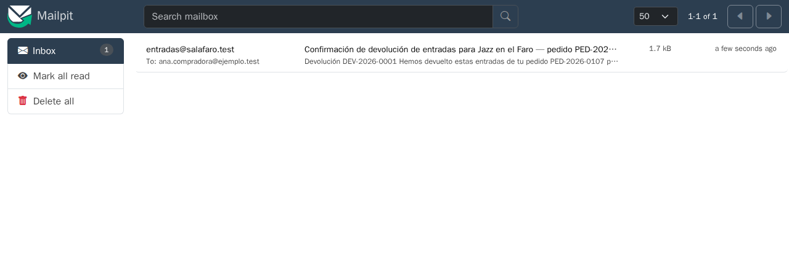

# Laboratorio: el correo que llegaba tres veces

[← Página anterior](03-lab-caso-limite-redondeo.md) · [Siguiente página →](../M04-documentacion-y-automatizacion/README.md)

Una compradora de la Sala Faro escribe al soporte: ha devuelto dos entradas y le han llegado tres correos de confirmación. ¿Le han devuelto el dinero tres veces? En este lab reproduces el fallo en Mailpit, le das al asistente la traza completa y le pides la causa antes que el arreglo. Después eliges entre el arreglo que tapa este caso y el que evita la familia entera de fallos.

### Objetivo

El correo de devolución sale una sola vez aunque la cola reintente el trabajo, comprobado en un test y en Mailpit.

### Punto de partida

- El repositorio del curso abierto en el Dev Container (local o Codespaces), con dos terminales en `telon/`.
- Terminal 1: `CONFIRM=1 make init-m03`; responde `telon/ está en el punto de partida de m03.`
- Terminal 2: `make up-m03`, y déjala abierta: ahí sale la traza del notifier.
- Mailpit abierto en el navegador (local: `http://localhost:8025`; Codespaces: pestaña **Ports** → **Mailpit (8025)** → icono del globo).
- Un asistente en modo agente:

| Asistente | Cómo abrir una conversación nueva |
|-----------|-----------------------------------|
| VS Code o Codespaces + Copilot | <kbd>Ctrl</kbd>+<kbd>Alt</kbd>+<kbd>I</kbd> → **+** → modo **Agent** bajo la caja de texto |
| Cursor | <kbd>Ctrl</kbd>+<kbd>L</kbd> → **+** → modo **Agent** |
| Claude Code | En una terminal nueva: `claude` |

> [!NOTE]
> El asistente tiene el código y `AGENTS.md`, que su herramienta carga al abrir cada conversación. No ve la terminal de `make up-m03` ni Mailpit: lo que pase ahí solo lo sabe si se lo pegas.

### En qué consiste

Reproducir, leer la traza, diagnosticar con el asistente, decidir el arreglo, probarlo con un test y verificar en Mailpit. Tocas `services/notifier` y una migración nueva.

### 1 — Reproduce el fallo

**Acción:**
1. En la terminal 1, `npm run db:reset`.
2. En Mailpit, pulsa **Delete all** para empezar con la bandeja vacía.
3. En la terminal 1, devuelve F-12 y F-13 del pedido de Ana:

```bash
curl -s localhost:3000/api/public/orders/PED-2026-0107/refunds \
  -H 'x-telon-tenant-slug: sala-faro' -H 'content-type: application/json' \
  -d '{"email":"ana.compradora@ejemplo.test","ticket_ids":["PED-2026-0107-1","PED-2026-0107-2"]}'
```

4. Espera diez segundos y refresca Mailpit.

**Por qué:** un fallo que no reproduces no lo puedes dar por arreglado. Con la base de datos limpia y la bandeja vacía, lo que veas es de este intento.

**Resultado esperado:** la API responde con `DEV-2026-0001`. En Mailpit hay **tres** correos iguales: «Confirmación de devolución de entradas para Jazz en el Faro — pedido PED-2026-0107».


### 2 — Lee la traza del notifier

**Acción:** en la terminal 2 (la de `make up-m03`), busca las líneas `[correo]` de `refund-confirmed`. Si hay mucho texto, haz clic en la terminal y pulsa <kbd>Ctrl</kbd>+<kbd>F</kbd> para buscar `refund-confirmed`. Selecciona las seis líneas y cópialas: las necesitas en el paso 3.

**Por qué:** la traza dice qué falló y cuántas veces. Es lo primero que le vas a dar al asistente, entera y sin resumir.

**Resultado esperado:**

```text
[correo] → refund-confirmed #3 (intento 1)
[correo] ✗ refund-confirmed #3: value too long for type character varying(80)
[correo] → refund-confirmed #3 (intento 2)
[correo] ✗ refund-confirmed #3: value too long for type character varying(80)
[correo] → refund-confirmed #3 (intento 3)
[correo] ✗ refund-confirmed #3: value too long for type character varying(80)
```

El número del trabajo (`#3`) puede ser otro. El trabajo falla las tres veces y aun así llegan tres correos.

### 3 — Pide la causa, no el arreglo

**Acción:** ve al chat, abre una conversación nueva, pega esto y pulsa <kbd>Enter</kbd>:

```text
Fallo: al devolver entradas, la compradora recibe 3 correos de confirmación. Traza del notifier:
[aquí, las seis líneas copiadas en el paso 2]
Ficheros: services/notifier/src/jobs.ts (sendRefundConfirmed, logEmail),
services/api/src/queue.ts (enqueueEmail), services/api/migrations/001_init.sql (email_log).
Explícame la causa paso a paso. No propongas arreglo todavía.
```

**Por qué:** con la traza, los ficheros y la orden de no arreglar, el asistente razona sobre el código real. Sin la orden, suele saltar al primer arreglo que hace desaparecer el error.

**Resultado esperado:** el agente abre los tres ficheros y explica la cadena completa:
1. `sendRefundConfirmed` envía el correo y **después** llama a `logEmail`.
2. El asunto mide 82 caracteres y `email_log.subject` es `varchar(80)`: el `INSERT` falla.
3. El trabajo lanza una excepción y BullMQ lo reintenta (`attempts: 3`).
4. Cada reintento vuelve a enviar antes de volver a fallar.

Si la explicación se queda en el punto 2 («el asunto es demasiado largo») sin mencionar el orden de envío y registro, pregúntale: «¿Por qué llegan tres correos si el registro falla?». Sin la traza, lo habitual es que el modelo culpe a la cola («BullMQ entrega el trabajo varias veces») o al proveedor, porque es lo más común.

### 4 — Compara dos arreglos

**Acción:** en el mismo chat, pega esto y pulsa <kbd>Enter</kbd>:

```text
Dame dos arreglos posibles con su diff aproximado:
A) el mínimo que hace desaparecer este error;
B) el que garantiza que un correo no sale dos veces aunque falle cualquier paso después del
   envío, según la regla de AGENTS.md sobre la cola.
¿Qué fallos futuros evita B que A no evita?
```

**Por qué:** el diff más pequeño que deja el test en verde no siempre es el arreglo bueno. Ampliar la columna arregla este asunto largo, pero mañana fallará otra cosa después del envío (la red, un `deadlock`) y volverán los duplicados.

**Resultado esperado:**
- **A:** ampliar `subject` a `text` con una migración nueva.
- **B:** idempotencia. Antes de enviar se reserva una clave única (`refund-confirmed:DEV-2026-0001`) en `email_log`; si ya existe, no se envía; si el envío falla, se libera la clave para que el reintento lo intente de nuevo.

B evita los duplicados por cualquier fallo posterior al envío, y también si alguien encola el mismo trabajo dos veces.

### 5 — Escribe el test antes del arreglo

**Acción:** en el mismo chat, pega esto y pulsa <kbd>Enter</kbd>:

```text
Crea services/notifier/test/once.test.ts para una función sendOnce(key, tenantId, provider,
email, jobId) que todavía no existe, en services/notifier/src/once.ts. Mockea ../src/db.js
simulando la restricción única de dedupe_key. Casos:
- llamada dos veces con la misma clave → el proveedor envía una vez y la segunda devuelve
  'already-sent';
- si el proveedor falla la primera vez, la segunda llamada sí envía.
```

**Por qué:** el test fija qué significa «una sola vez», incluido el caso del fallo de envío, que es el que un arreglo con prisa olvida: si reservas la clave y el envío falla, el correo no saldría nunca.

**Resultado esperado:** el agente crea el test y lo ejecuta. Falla porque `once.ts` no existe (`Failed to load url ../src/once.js` o parecido). Es lo esperado. Si el agente crea también `once.ts` sin que se lo pidas, rechaza ese fichero: el test va primero.

### 6 — Implementa el arreglo B

**Acción:** en el mismo chat, pega esto y pulsa <kbd>Enter</kbd>:

```text
Implementa:
1. Migración services/api/migrations/003_email_once.sql: subject a text y columna dedupe_key
   text UNIQUE en email_log.
2. services/notifier/src/once.ts con sendOnce: INSERT ... ON CONFLICT (dedupe_key) DO NOTHING
   RETURNING id; si no hay fila, 'already-sent'; si no, enviar; si el envío falla, DELETE de la
   clave y relanzar.
3. Usa sendOnce en sendOrderConfirmed y sendRefundConfirmed con las claves
   order-confirmed:<pedido> y refund-confirmed:<devolución>.
No toques los tests.
```

**Por qué:** la migración amplía la columna (el arreglo A va incluido) y añade la clave. `sendOnce` deja la regla en un solo sitio, y la confirmación de compra tenía el mismo fallo latente.

**Resultado esperado:** diff en `services/api/migrations/`, `services/notifier/src/once.ts` y `jobs.ts`. `logEmail` deja de usarse en los dos correos transaccionales.

### 7 — Pasa los tests

**Acción:** en la terminal 1, `npm test && npm run typecheck && npm run lint`

**Por qué:** el test del paso 5 pasa a verde y el resto sigue igual.

**Resultado esperado:** todo en verde.

### 8 — Verifica en Mailpit

**Acción:**
1. Comprueba que `[api]` y `[correo]` se han reiniciado solos al cambiar los ficheros (si no, reinicia `make up-m03`). La API aplica la migración 003 al arrancar.
2. En la terminal 1, `npm run db:reset`; en Mailpit, **Delete all**; y en la terminal 1, repite el `curl` del paso 1.

**Por qué:** el test prueba `sendOnce` con una base de datos simulada; esto prueba el sistema real, con PostgreSQL, Redis y Mailpit.

**Resultado esperado:** un único correo en Mailpit, y en la traza `✓ refund-confirmed` al primer intento.



### 9 — Haz commit

**Acción:** en la terminal 1, `git add services && git commit -m "Correos idempotentes: una devolución, un correo"`

**Por qué:** el arreglo, su migración y su test van juntos.

**Resultado esperado:** commit con la migración 003, `once.ts`, `jobs.ts` y el test.

## Comprueba tu entendimiento

**Encolar dos veces**
Con el arreglo puesto, pide al asistente un script de una sola vez que encole a mano otro trabajo `refund-confirmed` para `DEV-2026-0001`.
→ El notifier lo procesa con `✓`, pero en Mailpit no aparece un segundo correo: la clave ya existe.

**El proveedor caído**
En el backoffice (`faro-dev-token`), cambia el proveedor de la Sala Faro a **Mailgun (emulado)** sin rellenar `domain` y haz una devolución nueva.
→ La traza muestra `✗ … mailgun: falta configurar domain` en los tres intentos y no queda ninguna fila de esa devolución en `email_log`: la clave se libera en cada fallo. Vuelve a **SMTP** al terminar.

## Reto

### 1 — Las ventanas de fallo, con el asistente

`sendOnce` reserva la clave, envía y, si el envío falla, la libera. Pero el proceso del notifier puede morir en cualquier punto. Escribe un prompt para que el asistente haga una tabla de los puntos en los que puede morir el proceso dentro de `sendOnce` y, para cada uno, cuántos correos llegan (cero, uno o dos) cuando BullMQ reintenta. Que escriba un test con mocks para uno de los casos.

<details>
<summary>Ver solución</summary>

Un prompt que funciona:

```text
Analiza services/notifier/src/once.ts. Haz una tabla: punto en el que muere el proceso
(antes de reservar, tras reservar y antes de enviar, tras enviar y antes de devolver),
qué queda en email_log y cuántos correos llegan cuando BullMQ reintenta el trabajo.
Después escribe en services/notifier/test/once.test.ts un test que simule el caso
"tras reservar y antes de enviar" con los mocks que ya hay. No cambies once.ts.
```

Lo que tiene que salir: si muere antes de reservar, el reintento envía uno. Si muere tras enviar y antes de devolver, la clave queda reservada y el reintento no reenvía: llega uno. Si muere tras reservar y antes de enviar, la clave queda sin correo y no llega ninguno. Ningún diseño da «exactamente una vez» con un proveedor externo: este elige «como mucho una vez» para correos de confirmación.

La habilidad es pedirle al asistente un análisis exhaustivo con un formato que obligue a cubrir todos los casos (la tabla) y una prueba ejecutable de uno de ellos, en lugar de una explicación que puede saltarse el caso incómodo.

</details>

## Errores frecuentes

| Síntoma | Causa probable | Cómo arreglarlo |
|---------|----------------|-----------------|
| Siguen llegando tres correos | El notifier no se ha reiniciado o la migración 003 no se aplicó | Reinicia `make up-m03`; la línea `[api] migraciones aplicadas: 003_email_once.sql` lo confirma |
| `there is no unique or exclusion constraint matching the ON CONFLICT` | La columna `dedupe_key` no tiene `UNIQUE` | Revisa la migración 003 y repite `npm run db:reset` |
| El test de `sendOnce` cuelga | `once.ts` importa el `pool` real | El `vi.mock('../src/db.js')` tiene que ir antes de importar `once.ts` |
