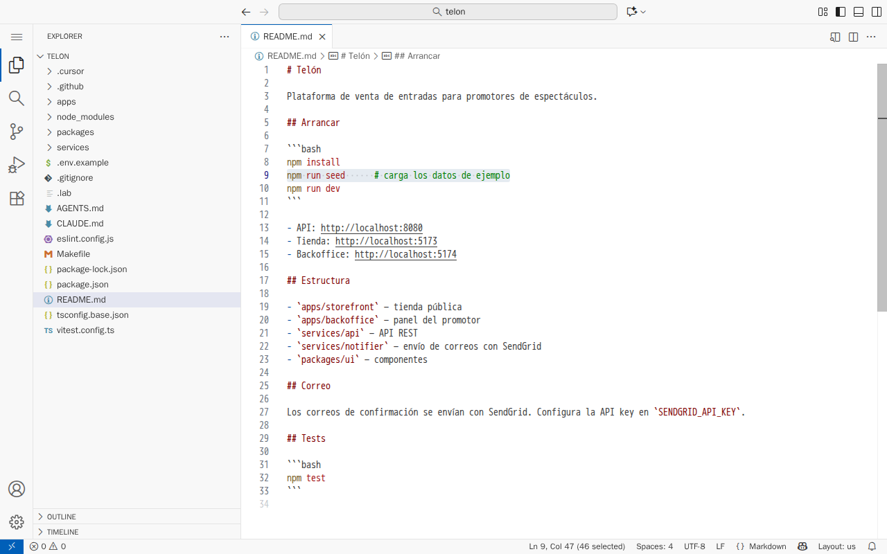
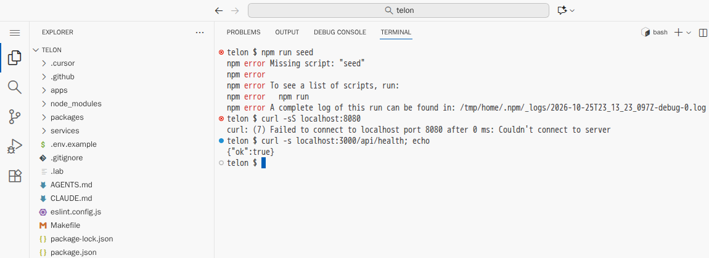
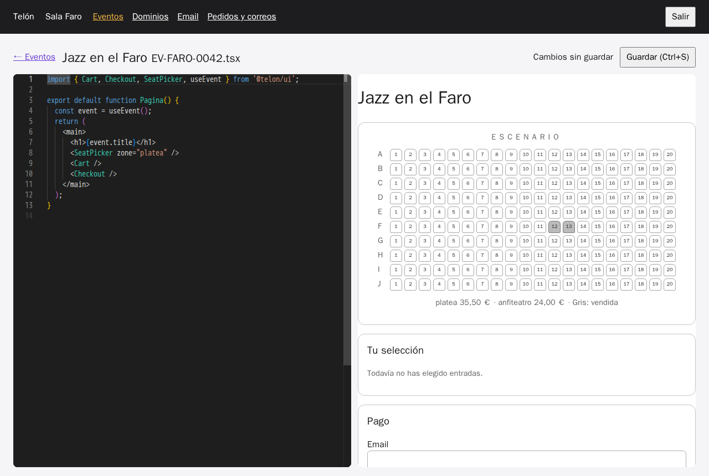
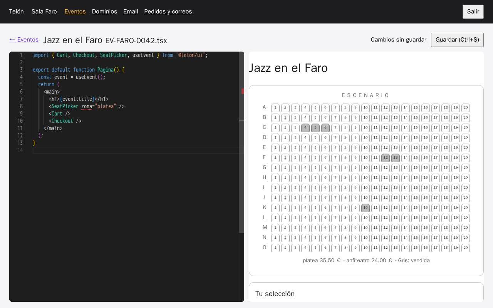

# Documentar lo que hay

[← Página anterior](README.md) · [Siguiente página →](01-lab-readme-y-openapi.md)

Un asistente escribe documentación que se lee bien en segundos. El riesgo es que se lea bien y sea falsa: si parte de un README antiguo, hereda sus errores y les añade otros nuevos igual de creíbles. El `README.md` del proyecto Telón se escribió cuando la plataforma tenía la mitad de piezas y ya no cuadra con el código. Esta demostración le pide al asistente que lo actualice de dos maneras, leyéndolo y ejecutándolo, y compara qué afirmaciones son ciertas en cada resultado.

## Punto de partida

- El repositorio del curso abierto en el Dev Container (VS Code local o Codespaces), con **dos** terminales abiertas en `telon/`. Para la segunda, pulsa el **+** del panel de terminal.
- Un asistente en modo agente. En Copilot o Cursor, la vista de chat con el selector de modo en **Agent**. En Claude Code, `claude` en la terminal, dentro de `telon/`.
- Lo que es cierto hoy, comprobado en el código y ejecutando:
  - la API escucha en el puerto 3000 (`curl localhost:3000/api/health` responde `{"ok":true}`);
  - no existe `npm run seed`: los datos se cargan al arrancar la API y con `npm run db:reset`;
  - la API aplica las migraciones al arrancar, y no hay `npm run migrate`;
  - el proveedor de correo lo configura cada promotor en el backoffice; no hay ninguna variable `SENDGRID_API_KEY`.

### Preparación

**Paso A — Deja el proyecto en el estado de partida.**
En la terminal 1, escribe `CONFIRM=1 make init-m04`.
**Resultado esperado:** `telon/ está en el punto de partida de m04.` La devolución está hecha y probada, y el README es el heredado.

**Paso B — Arranca la plataforma.**
En la terminal 2, escribe `make up-m04` y déjala abierta.
**Resultado esperado:** líneas de `[api]`, `[pagos]`, `[correo]`, `[tienda]`, `[backoffice]` y `[editor]`, y ningún error.

**Paso C — Enseña el README heredado.**
Pulsa <kbd>Ctrl</kbd>+<kbd>P</kbd>, escribe `README.md` y elige el de la raíz de `telon/` (no el de `docs/` ni el de otras carpetas).
**Resultado esperado:** el README del proyecto. Fíjate en tres líneas:

- línea 9: `npm run seed      # carga los datos de ejemplo`;
- línea 13: `- API: http://localhost:8080`;
- línea 27: `Los correos de confirmación se envían con SendGrid. Configura la API key en SENDGRID_API_KEY.`



Las tres son falsas. De momento no se dice: se trata de ver si el asistente lo descubre. Cierra la pestaña.

> [!NOTE]
> El texto exacto que genera el asistente cambia con el modelo. Lo que se repite es qué afirmaciones son ciertas con cada método.

## Recorrido

### Paso 1 — Actualizar leyendo: el README nuevo hereda los errores del viejo

**1.1 Pide la actualización.**
**Dónde:** conversación nueva en modo agente.
**Qué haces:** escribe y pulsa <kbd>Enter</kbd>:

```text
Actualiza el README.md con la funcionalidad de devoluciones.
```

**Resultado esperado:** el agente lee `README.md`, `AGENTS.md` y algún fichero de `services/api/src/refunds/`, y modifica `README.md`. Si pide permiso para guardar, acéptalo: el cambio se descarta al final.

**1.2 Mira lo que ha cambiado.**
**Qué haces:** en la terminal 1, escribe `git diff README.md`.
**Resultado esperado:** una sección «Devoluciones» nueva y correcta. Pero las líneas de `npm run seed`, el puerto 8080 y `SENDGRID_API_KEY` siguen igual, sin marcar con `+` ni con `-`. A menudo aparece además una línea nueva igual de falsa, como `npm run migrate` «para aplicar las migraciones».

**1.3 Compruébalo en directo.**
**Qué haces:** en la terminal 1, escribe `npm run seed`.
**Resultado esperado:** `npm error Missing script: "seed"`.

**Por qué pasa:** se le pidió actualizar un texto, y el asistente lo ha hecho a partir de otro texto. No tenía ningún motivo para dudar del README, porque nada en el prompt le pedía comprobarlo. Lo que inventa, como el `npm run migrate`, es tan creíble como lo que copia: es lo que tienen muchos proyectos parecidos.

**1.4 Descarta el cambio.**
**Qué haces:** en la terminal 1, `git checkout README.md`, y cierra la conversación.

### Paso 2 — Actualizar ejecutando: cada línea con su comprobación

**2.1 Pide la revisión, con otro método.**
**Dónde:** conversación **nueva** en modo agente.
**Qué haces:** escribe y pulsa <kbd>Enter</kbd>:

```text
Revisa el README.md afirmación por afirmación. Para cada comando, ejecútalo. Para cada URL,
haz una petición. Para cada afirmación sobre el código, busca el fichero que la demuestra.
Dame una tabla: afirmación, cómo lo has comprobado, ¿es cierta? Después reescríbelo
solo con lo comprobado.
```

**2.2 Acepta solo los comandos de lectura.**
**Qué haces:** el agente pide permiso antes de cada comando. Acepta los que solo leen o fallan sin efectos: `npm run seed`, `curl`, búsquedas en el repositorio. Si pide algo que cambia datos (por ejemplo, `npm run db:reset`), puedes aceptarlo también: solo afecta al entorno de desarrollo.
**Resultado esperado:** el agente ejecuta y enseña cada resultado. Son los mismos que salen al hacerlo a mano:



- `npm run seed` → `Missing script: "seed"`;
- `curl localhost:8080` → `Failed to connect … port 8080`;
- `curl localhost:3000/api/health` → `{"ok":true}`;
- la búsqueda de `SENDGRID_API_KEY` → ningún resultado en el código.

**2.3 Lee la tabla antes que el README.**
**Resultado esperado:** una tabla con unas seis afirmaciones marcadas como falsas. Después, `git diff README.md` muestra un README más corto, en el que cada línea tiene detrás una comprobación que se puede repetir.

**Por qué pasa:** el objetivo es el mismo, pero el método ha cambiado. Un agente puede ejecutar comandos, y ejecutándolos encuentra lo que leyendo no ve. Sin la instrucción explícita de comprobar, no lo hace: por defecto redacta.

**2.4 Descarta el cambio.**
**Qué haces:** en la terminal 1, `git checkout README.md`.

### Paso 3 — El mismo método con la documentación de un componente

Los promotores montan sus páginas con componentes como `SeatPicker`, y su documentación incluye un ejemplo de uso. La forma de comprobar ese ejemplo es pegarlo en el editor del backoffice.

**3.1 Abre el editor de la página del evento.**
**Dónde:** en el navegador, el backoffice (local: `http://localhost:5174`; Codespaces: pestaña **Ports** → **Backoffice (5174)** → icono del globo).
**Qué haces:**
1. En **Token**, escribe `faro-dev-token` y pulsa **Entrar**.
2. En **Eventos**, pulsa **Editar página** en la fila de «Jazz en el Faro».

**Resultado esperado:** el editor de código a la izquierda y la vista previa de la página a la derecha.

**3.2 Pega el ejemplo de la documentación.**
**Qué haces:** haz clic en el editor de la izquierda, selecciona todo con <kbd>Ctrl</kbd>+<kbd>A</kbd> y pega este código:

```tsx
import { Cart, Checkout, SeatPicker, useEvent } from '@telon/ui';

export default function Pagina() {
  const event = useEvent();
  return (
    <main>
      <h1>{event.title}</h1>
      <SeatPicker zone="platea" />
      <Cart />
      <Checkout />
    </main>
  );
}
```

**Resultado esperado:** la vista previa muestra solo la platea (filas A a J), el carrito y el pago. Arriba aparece «Cambios sin guardar».



**3.3 Introduce el error típico.**
**Qué haces:** en la línea 8, cambia `zone="platea"` por `zona="platea"`.
**Resultado esperado:** `zona` queda subrayada en rojo y la vista previa vuelve a mostrar todas las zonas, de la A a la O.



**Por qué pasa:** el editor del backoffice comprueba el ejemplo con los mismos tipos que usará el promotor. Una prop que no existe se subraya, y el componente la ignora. Un ejemplo que funciona ahí funciona en la página del promotor; uno escrito sin probarlo puede no hacerlo.

**3.4 No guardes.**
**Qué haces:** no pulses **Guardar**. Recarga la página del navegador (<kbd>F5</kbd>) y acepta descartar los cambios si te lo pregunta.

## Qué queda visto

| Documento | Cómo se verifica |
|-----------|------------------|
| README | Cada comando se ejecuta tal cual en una terminal limpia; cada URL responde |
| OpenAPI | El esquema pasa un linter y una petición real devuelve lo que dice |
| Documentación de un componente | El ejemplo, pegado en el editor del backoffice, funciona |

La documentación generada vale lo que valen sus comprobaciones. Si el asistente solo lee, repite los errores que encuentra; si ejecuta, los descubre.

En [01 — README y OpenAPI](01-lab-readme-y-openapi.md) lo haces tú. Se puede hacer sin haber seguido esta demostración.
