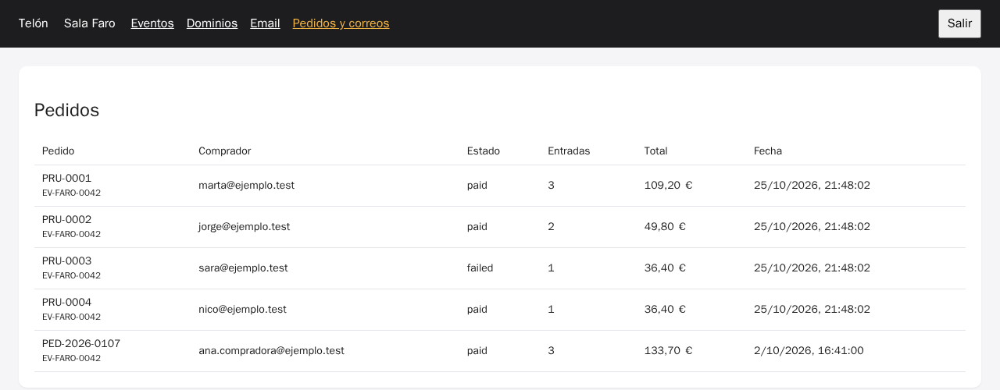

# Laboratorio: script de escenario, documentación de componente y prompts reutilizables

[← Página anterior](01-lab-readme-y-openapi.md) · [Siguiente página →](../M05-workflows-con-ia/README.md)

Cada vez que alguien del equipo prueba devoluciones en el proyecto Telón, repite lo mismo: crea pedidos en distintos estados, devuelve alguno y busca un evento que esté a menos de 48 h. En este lab conviertes esa tarea en un script con el asistente. Después documentas `SeatPicker` para los promotores, con un ejemplo comprobado en el editor, y guardas el prompt que has usado para que el equipo lo reutilice.

### Objetivo

`npm run escenario` crea datos de prueba de devoluciones y se puede ejecutar varias veces. `docs/componentes/SeatPicker.md` tiene un ejemplo que funciona en el editor del backoffice. Y queda un prompt reutilizable versionado para tu asistente.

### Punto de partida

- El repositorio del curso abierto en el Dev Container (local o Codespaces), con dos terminales en `telon/`.
- Terminal 1: `CONFIRM=1 make init-m04`; responde `telon/ está en el punto de partida de m04.`
- Terminal 2: `make up-m04`, y déjala abierta. Cuando arranque, en la terminal 1: `npm run db:reset`.
- El backoffice abierto en el navegador (local: `http://localhost:5174`; Codespaces: pestaña **Ports** → **Backoffice (5174)** → icono del globo), con el token `faro-dev-token`.
- Un asistente en modo agente:

| Asistente | Cómo abrir una conversación nueva |
|-----------|-----------------------------------|
| VS Code o Codespaces + Copilot | <kbd>Ctrl</kbd>+<kbd>Alt</kbd>+<kbd>I</kbd> → **+** → modo **Agent** bajo la caja de texto |
| Cursor | <kbd>Ctrl</kbd>+<kbd>L</kbd> → **+** → modo **Agent** |
| Claude Code | En una terminal nueva: `claude` |

> [!NOTE]
> El asistente tiene el código y `AGENTS.md`, que su herramienta carga al abrir cada conversación. No sabe que los pedidos pagados tienen que existir también en la pasarela emulada: no está escrito en ninguna parte, y por eso el prompt del paso 1 lo dice.

### En qué consiste

Un script en `services/api/src/scripts/`, una página de documentación y un fichero de prompt. No cambias la lógica del proyecto.

### 1 — Describe el escenario que necesitas

**Acción:** ve al chat, abre una conversación nueva, pega esto y pulsa <kbd>Enter</kbd>:

```text
Crea services/api/src/scripts/escenario.ts y el script npm "escenario" (en services/api y en la
raíz), que añada al evento EV-FARO-0042:
- PRU-0001: pagado, 3 butacas de platea (C-4, C-5, C-6);
- PRU-0002: pagado, K-10 y K-11, con K-11 ya devuelta (registro en refunds y refund_tickets);
- PRU-0003: rechazado (D-1, entrada void);
- PRU-0004: pagado, A-1 devuelta;
- un evento EV-FARO-0099 que empieza dentro de 24 h, con un pase De pie, para probar el plazo de 48 h.
Importes con ticketAmounts de pricing.ts. Los pedidos pagados tienen que cobrarse de verdad en
la pasarela emulada (charge de payments-client) para que se puedan devolver.
Idempotente: si ya existen, bórralos y vuelve a crearlos, incluido lo que alguien haya comprado
en EV-FARO-0099. Nada más.
```

**Por qué:** es una tarea que el asistente hace bien si le das el detalle: qué datos, de dónde salen los importes y que se pueda repetir. Lo de cobrar en la pasarela es lo que nadie recuerda y lo que hace que la primera devolución de prueba falle con un 502.

**Resultado esperado:** el agente lee `seed.ts`, `pricing.ts`, `payments-client.ts` y las migraciones, y crea `services/api/src/scripts/escenario.ts`, de unas 80 líneas, y el script `"escenario"` en los dos `package.json`. A veces lo ejecuta para probarlo; si pide permiso, acéptalo.

### 2 — Revisa lo que borra

**Acción:** abre `escenario.ts` (<kbd>Ctrl</kbd>+<kbd>P</kbd> → `escenario.ts`) y busca todos los `DELETE` con <kbd>Ctrl</kbd>+<kbd>F</kbd>.

**Por qué:** un script de datos idempotente borra antes de crear. Un `DELETE FROM orders` sin filtro se lleva el pedido de Ana y todo lo que hayas comprado en la tienda.

**Resultado esperado:** todos los `DELETE` filtran por pedidos `PRU-%` o del evento `EV-FARO-0099`, y se borra en orden: primero `refund_tickets`, después `refunds`, `tickets`, `orders` y `events`. Si no, la segunda ejecución choca con las claves foráneas.

### 3 — Ejecútalo dos veces

**Acción:** en la terminal 1:

```bash
npm run escenario
npm run escenario
```

**Por qué:** la segunda ejecución prueba que es idempotente. Es lo que hará cualquiera que lo use sin pensar.

**Resultado esperado:** las dos terminan con un mensaje del tipo «escenario cargado: 4 pedidos PRU-* y el evento EV-FARO-0099». En el backoffice, **Pedidos y correos** muestra `PRU-0001` a `PRU-0004` una sola vez.



### 4 — Prueba una devolución sobre el escenario

**Acción:**

```bash
curl -s localhost:3000/api/public/orders/PRU-0001/refunds \
  -H 'x-telon-tenant-slug: sala-faro' -H 'content-type: application/json' \
  -d '{"email":"marta@ejemplo.test","ticket_ids":["PRU-0001-1"]}'
```

**Por qué:** si el script no cobró en la pasarela, aquí sale un 502. Es la prueba de que los datos sirven para lo que se crearon.

**Resultado esperado:** `201` con `amount_cents: 3550`.

### 5 — Documenta `SeatPicker`

**Acción:** ve al chat, abre una conversación nueva, pega esto y pulsa <kbd>Enter</kbd>:

```text
Crea docs/componentes/SeatPicker.md para promotores que escriben su página en TSX: qué hace,
un ejemplo de uso mínimo con Cart y Checkout, tabla de props, comportamiento (máximo de
entradas, butacas vendidas, recarga tras el pago) y cómo cambiar el color con --telon-accent.
Sácalo de packages/ui/src/SeatPicker.tsx y context.tsx. Solo props que existan.
```

**Por qué:** el promotor no ve el código de `@telon/ui`, solo el editor y la documentación. Una prop inventada en la documentación es un ticket de soporte.

**Resultado esperado:** `docs/componentes/SeatPicker.md`, con un ejemplo de unas 15 líneas y una tabla con una sola prop, `zone`. Si la tabla tiene más props (`maxSeats`, `onSelect`…), el modelo las ha sacado de componentes parecidos de otras librerías: pídele que cite la línea de `SeatPicker.tsx` de cada una y quita las que no tengan.

### 6 — Comprueba el ejemplo en el editor

**Acción:**
1. En el backoffice, ve a **Eventos** → **Editar página** en la fila de «Jazz en el Faro».
2. Selecciona todo el código del editor (<kbd>Ctrl</kbd>+<kbd>A</kbd>) y pega el ejemplo de la documentación.
3. Mira la vista previa. **No guardes.**

**Por qué:** así se verifica la documentación de un componente: con el mismo editor y el mismo runtime que usa el promotor.

**Resultado esperado:** la vista previa muestra el plano (solo la platea si el ejemplo usa `zone="platea"`), el carrito y el pago, sin errores en rojo. Si Monaco subraya algo o la vista previa muestra «Error en la página del evento», el ejemplo está mal: corrígelo en la documentación.


### 7 — Guarda el prompt para el equipo

**Acción:** crea el fichero de tu asistente (en el explorador, clic derecho en el espacio vacío bajo los ficheros de `telon/` → **New File…**, escribe la ruta completa con las barras), pega el contenido y guarda con <kbd>Ctrl</kbd>+<kbd>S</kbd>:

| Asistente | Fichero | Se usa con |
|-----------|---------|------------|
| GitHub Copilot | `.github/prompts/documentar-componente.prompt.md` | `/documentar-componente` en el chat |
| Cursor | `.cursor/commands/documentar-componente.md` | `/documentar-componente` en el chat |
| Claude Code | `.claude/commands/documentar-componente.md` | `/documentar-componente` en `claude` |

Contenido (igual para los tres):

```markdown
Documenta el componente $ARGUMENTS de packages/ui para promotores que escriben su página en TSX.
Crea docs/componentes/$ARGUMENTS.md con: qué hace, ejemplo mínimo dentro de una página
(export default), tabla de props (solo las que existan en el código), comportamiento y estilos.
Sácalo de packages/ui/src/. Al terminar, dime cómo comprobar el ejemplo en el editor del backoffice.
```

**Por qué:** un prompt que funciona es conocimiento del equipo. Si se queda en tu historial de chat, se pierde. Versionado, lo usa cualquiera y se mejora por pull request.

**Resultado esperado:** el fichero creado. Abre una conversación nueva y escribe `/`: el comando `documentar-componente` aparece en la lista. Escribe `/documentar-componente PassSelector` y pulsa <kbd>Enter</kbd>: genera `docs/componentes/PassSelector.md`.

> [!NOTE]
> En Copilot, la variable del argumento se escribe distinto según la versión (`${input:componente}`). Si `$ARGUMENTS` no se sustituye, cambia esa palabra por el nombre del componente al usarlo.

### 8 — Haz commit

**Acción:** en la terminal 1, `git add -A && git commit -m "Escenario de devoluciones, documentación de SeatPicker y prompt reutilizable"`

**Por qué:** script, documentación y prompt son herramientas del equipo. Van al repositorio.

**Resultado esperado:** commit con el script, los `package.json`, `docs/` y el fichero de prompt.

## Comprueba tu entendimiento

**El plazo, con datos**
Con el escenario cargado, compra un pase **De pie** de «Jam de mañana» en la tienda (`/e/EV-FARO-0099`) y devuélvelo desde **Mis entradas**.
→ «las devoluciones cierran 48 h antes del evento». El escenario te ha dado el caso sin tocar fechas a mano.

**El prompt en otro componente**
Usa `/documentar-componente Checkout`.
→ Genera `docs/componentes/Checkout.md` sin props en la tabla (`Checkout` no tiene) y con las tres tarjetas de prueba.

## Reto

### 1 — Un prompt reutilizable para scripts de datos seguros

El paso 2 lo revisaste tú a mano: que ningún `DELETE` se lleve datos reales. Escribe un prompt reutilizable (en el sitio de tu asistente, como el del paso 7) que obligue al asistente a hacer esa revisión cada vez que toque un script de datos. Pruébalo pidiendo que el escenario cree también un pedido pagado del Teatro Lumen.

<details>
<summary>Ver solución</summary>

Un prompt reutilizable que funciona, por ejemplo en `.claude/commands/script-datos.md` (o el equivalente de tu asistente):

```markdown
Cambia el script de datos así: $ARGUMENTS
Reglas:
- Antes de terminar, lista cada DELETE del script con su WHERE y explica qué filas reales
  podría borrar. Ningún DELETE sin filtro por ids de prueba (PRU-%) o eventos de prueba.
- Orden de borrado compatible con las claves foráneas.
- Ejecuta el script dos veces seguidas y enséñame las dos salidas.
- Los pedidos pagados se cobran en la pasarela emulada con charge().
```

Al usarlo con «añade un pedido pagado PRU-0005 del Teatro Lumen», el asistente tiene que ver que ese evento (`EV-LUMEN-0007`) no tiene butacas y usar un pase (`EV-LUMEN-0007-GEN`, con `kind = 'pass'`). Lo que no debe proponer es filtrar los `DELETE` por `tenant_id = 'TN-FARO'`, porque eso borraría los pedidos reales de la Sala Faro. La lista de `DELETE` que pide el prompt es lo que te deja verlo sin leer el script entero.

La habilidad es convertir una revisión que hiciste a mano en una instrucción que el equipo reutiliza.

</details>

## Errores frecuentes

| Síntoma | Causa probable | Cómo arreglarlo |
|---------|----------------|-----------------|
| `duplicate key value violates unique constraint "orders_pkey"` | El script no borra antes de crear | Añade los `DELETE` del paso 2 |
| `502 la pasarela no ha podido hacer la devolución` | El pedido se creó sin cobrar en la pasarela | Usa `charge()` de `payments-client.ts` y guarda su `id` en `charge_id` |
| `fetch failed` al ejecutar el script | La pasarela no está arrancada | `make up-m04` en otra terminal |
| La vista previa dice `la página no puede importar «…»` | El ejemplo importa algo que no es `react` ni `@telon/ui` | Solo esos módulos están disponibles en las páginas |
