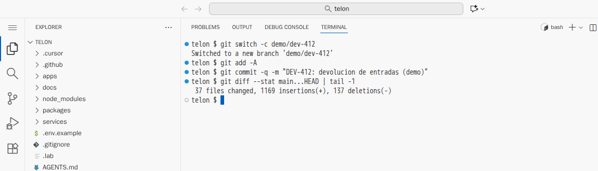
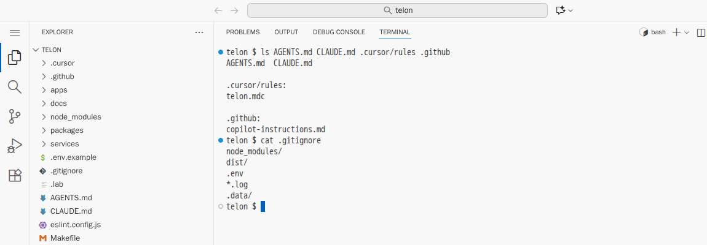
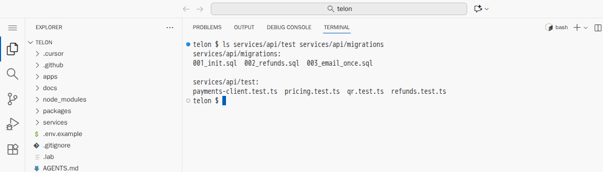

# El equipo y el asistente

[← Página anterior](README.md) · [Siguiente página →](01-lab-pull-request-revisado.md)

Hasta aquí, el asistente ha trabajado para una sola persona. En un equipo, el trabajo llega a `main` por un camino compartido: rama, pull request, revisión y CI. Esta demostración recorre ese camino con la devolución de entradas del proyecto Telón y enseña dos cosas en cada parada: qué puede acelerar el asistente y qué no puede decidir él. Qué se publica, qué se fusiona y qué se comparte lo deciden las personas y el repositorio.

## Punto de partida

- El repositorio del curso abierto en el Dev Container (VS Code local o Codespaces), con una terminal abierta en `telon/`.
- Un asistente en modo agente. En Copilot o Cursor, la vista de chat con el selector de modo en **Agent**. En Claude Code, `claude` en la terminal.
- La demostración trabaja solo en local, en una rama que se borra al final. No sube nada al fork.

### Preparación

**Paso A — Deja el proyecto en el estado de partida.**
En la terminal, escribe `CONFIRM=1 make init-m05`.
**Resultado esperado:** `telon/ está en el punto de partida de m05.` En `telon/` está el trabajo completo de la devolución (código, tests, README, OpenAPI y `AGENTS.md`), sin commit.

**Paso B — Crea una rama de demostración con ese trabajo.**
En la terminal, escribe estos comandos:

```bash
git switch -c demo/dev-412
git add -A
git commit -q -m "DEV-412: devolucion de entradas (demo)"
git diff --stat main...HEAD | tail -1
```

**Resultado esperado:** `Switched to a new branch 'demo/dev-412'` y, en la última línea, el tamaño del cambio: unos 37 ficheros. Es lo que vería quien revisa el pull request.



> [!NOTE]
> Si `git commit` responde `Author identity unknown`, configura tu nombre con `git config --global user.name "Tu nombre"` y `git config --global user.email "tu@correo"`, y repite el commit.

## Recorrido

### Paso 1 — Qué es del equipo y qué es de cada uno

**1.1 Enseña lo que viaja con el repositorio.**
**Qué haces:** en la terminal:

```bash
ls AGENTS.md CLAUDE.md .cursor/rules .github
cat .gitignore
```

**Resultado esperado:** `AGENTS.md` y `CLAUDE.md`, `telon.mdc` dentro de `.cursor/rules` y `copilot-instructions.md` dentro de `.github`. Después, el contenido de `.gitignore`, con `.env` en la lista.



**Por qué pasa:** las reglas y los punteros de cada herramienta están en el commit de la rama, así que entran por pull request como el código. Lo que está en `.gitignore`, como la configuración y los secretos de cada uno, no sale del puesto.

| En el repositorio (entra por PR) | En tu máquina (no se sube) |
|----------------------------------|----------------------------|
| `AGENTS.md`, `CLAUDE.md`, `.cursor/rules/`, `.github/copilot-instructions.md` | Historial de chats y «memorias» del asistente |
| Prompts reutilizables (`.github/prompts/`, `.cursor/commands/`, `.claude/commands/`) | Preferencias personales del editor y del asistente |
| Dev Container, `Makefile`, scripts | `.env`, tokens, la API key de tu cuenta del asistente |
| Workflow de CI | Cachés e índices del asistente |

Cuando el asistente descubre algo que vale para todos, no se deja en el chat. Por ejemplo: «la pasarela olvida los cargos si no se hace `db:reset` con ella arrancada». Se propone como cambio a `AGENTS.md` y entra por pull request, igual que el código. Lo que está solo en un chat lo aprovecha una persona una vez; lo que está en el repositorio lo aplican todos los asistentes del equipo a partir del siguiente `git pull`.

### Paso 2 — La descripción del pull request: la escribe el asistente, la firma una persona

**2.1 Pide la descripción.**
**Dónde:** conversación nueva en modo agente.
**Qué haces:** escribe y pulsa <kbd>Enter</kbd>:

```text
Escribe la descripción del PR a partir de git diff main...HEAD: qué cambia, por qué, cómo
probarlo (comandos exactos) y riesgos. Nada que no esté en el diff.
```

Cuando pida permiso para ejecutar `git diff`, acéptalo.
**Resultado esperado:** una descripción en Markdown con cuatro apartados. Acierta en lo importante: migraciones 002 y 003, `services/api/src/refunds/`, `sendOnce`, `RefundRequest` y OpenAPI.

**2.2 Comprueba dos afirmaciones.**
**Qué haces:** en la terminal, `ls services/api/test services/api/migrations`.
**Resultado esperado:** tres migraciones (`001`, `002` y `003`) y cuatro ficheros de test unitarios.



Compáralo con la descripción. Lo típico es que diga «se añaden tests de integración», y no los hay: los tests usan mocks y no levantan la base de datos.

**Por qué pasa:** el modelo resume el diff con las frases que suelen acompañar a un cambio así, y «tests de integración» es una de ellas. El asistente ahorra el trabajo de redactar, pero la descripción va firmada por quien abre el PR: si dice algo falso, el error es de esa persona.

### Paso 3 — La revisión: el asistente propone y quien revisa decide

**3.1 Pide una revisión con la lista del equipo.**
**Qué haces:** en la misma conversación, escribe y pulsa <kbd>Enter</kbd>:

```text
Revisa el diff de este PR (git diff main...HEAD) como revisor del equipo. Usa AGENTS.md
como lista de comprobación: reglas de negocio, convenciones, "No hacer". Para cada hallazgo:
fichero, línea, regla que incumple y gravedad (bloqueante / mejora / gusto). No cambies nada.
```

**Resultado esperado:** una lista de hallazgos con su gravedad. Suelen salir comentarios útiles, como un `DELETE` del script de escenario que convendría meter en una transacción o un mensaje de error en inglés, mezclados con otros de puro gusto, como renombrar variables.

**3.2 Decide qué se publica.**
**Qué haces:** recorre la lista y, para cada hallazgo, di en voz alta si se publica, se descarta o se discute.
**Por qué pasa:** el modelo tiende a dar muchos comentarios porque es lo que se espera de una revisión. Pedirle la gravedad ayuda a filtrar, pero el criterio final sigue siendo de quien revisa.

### Paso 4 — Más herramientas, con permisos acotados

**MCP** (Model Context Protocol) es la forma estándar de conectar el asistente a herramientas externas. Los **agentes especializados** son el mismo asistente con instrucciones y herramientas limitadas.

**4.1 Enseña dónde se ven en cada asistente.**

| Asistente | Servidores MCP | Agentes especializados |
|-----------|----------------|------------------------|
| Copilot (VS Code) | <kbd>F1</kbd> → **MCP: List Servers** | Modos y agentes personalizados del selector de la vista de chat |
| Cursor | **Cursor Settings** → sección MCP | Modos personalizados del chat |
| Claude Code | `/mcp` dentro de `claude` | `/agents` dentro de `claude` |

**Resultado esperado:** en este proyecto no hay ninguno configurado: la lista está vacía.

**4.2 Explica qué tendría sentido aquí.**

- el servidor MCP de GitHub, para leer issues y PR sin copiarlos al chat;
- un servidor MCP de PostgreSQL **de solo lectura** contra la base de datos de desarrollo, para que el agente consulte la tabla `tickets` en lugar de suponer su esquema;
- un agente «revisor» que solo lee y comenta, y un «escritor de tests» que solo toca `test/`.

Cada servidor MCP es código que se ejecuta con tus permisos. Uno con escritura sobre la base de datos de producción no tiene sitio en el día a día del equipo. Cuanto más puede hacer el asistente por su cuenta, más importa limitar qué puede hacer.

### Paso 5 — Qué medir para saber si funciona

Las líneas que genera el asistente no dicen nada útil. En este equipo se miden dos cosas:

- el tiempo desde que llega la petición (DEV-412) hasta que se fusiona el PR;
- el número de idas y vueltas en la revisión.

Con PR reales en GitHub, los datos salen de la propia herramienta, por ejemplo con `gh pr view <número> --json createdAt,mergedAt,reviews`. El objetivo es que bajen las dos sin que suban los fallos en producción.

### Deja el proyecto como estaba

**Qué haces:** en la terminal:

```bash
git switch main
git branch -D demo/dev-412
CONFIRM=1 make init-m05
```

**Resultado esperado:** `Deleted branch demo/dev-412` y `telon/ está en el punto de partida de m05.`

## Qué queda visto

| Paso hacia `main` | Qué hace el asistente | Qué decide una persona o el repositorio |
|-------------------|-----------------------|-----------------------------------------|
| Reglas y prompts | Propone cambios a `AGENTS.md` | El PR que los acepta |
| Descripción del PR | La redacta desde el diff | Quien la firma la corrige |
| Revisión | Comenta con `AGENTS.md` como lista | Quien revisa filtra y publica |
| Herramientas y agentes | Consulta y actúa | Los permisos que tiene |
| Resultado | — | Tiempo hasta el merge e idas y vueltas |

El asistente acelera cada paso, pero no decide ninguno: las reglas, los prompts y la CI son del repositorio, y la firma y la revisión, de las personas.

En [01 — Pull request revisado](01-lab-pull-request-revisado.md) llevas la devolución a `main`. Se puede hacer sin haber seguido esta demostración.
