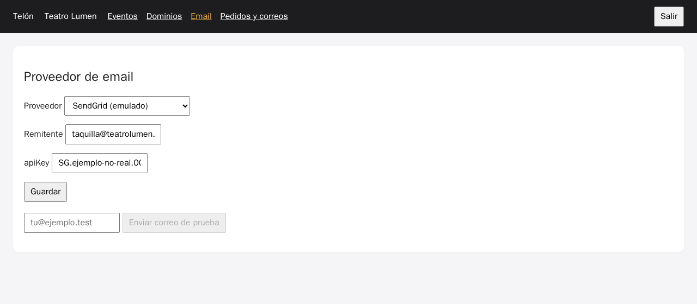

# Laboratorio: workflow de CI y revisión de seguridad

[← Página anterior](01-lab-pull-request-revisado.md) · [Siguiente página →](../M06-caso-integral/README.md)

El pull request de la devolución necesita algo que lo valide sin depender de que alguien ejecute los tests en su máquina. En este lab el asistente escribe el workflow de GitHub Actions, y hay que llevarlo a donde GitHub lo busca. Después revisas el PR con una lista de seguridad y encuentras una API key que el proyecto Telón devuelve en claro. Por último limitas lo que el agente puede ejecutar sin preguntarte.

### Objetivo

Un workflow que ejecuta lint, typecheck y tests del proyecto en cada push, en verde en tu PR. Además, la API key del proveedor de email enmascarada en el backoffice y una configuración del agente con lo que puede ejecutar solo y lo que no.

### Punto de partida

- Tu fork abierto en el Dev Container (local o Codespaces), con dos terminales en `telon/`.
- Si hiciste el [lab anterior](01-lab-pull-request-revisado.md), sigue en tu rama `feat/dev-412-devoluciones` con el PR abierto. Si no, en la terminal 1: `CONFIRM=1 make init-m05` y después los pasos 1, 2 y 5 de ese lab (rama, push y PR).
- Terminal 2: `make up-m05`, y déjala abierta.
- Un asistente en modo agente:

| Asistente | Cómo abrir una conversación nueva |
|-----------|-----------------------------------|
| VS Code o Codespaces + Copilot | <kbd>Ctrl</kbd>+<kbd>Alt</kbd>+<kbd>I</kbd> → **+** → modo **Agent** bajo la caja de texto |
| Cursor | <kbd>Ctrl</kbd>+<kbd>L</kbd> → **+** → modo **Agent** |
| Claude Code | En una terminal nueva: `claude` |

> [!NOTE]
> El asistente tiene el código y `AGENTS.md`, que su herramienta carga al abrir cada conversación. Su «raíz» es `telon/`: no ve el resto del repositorio salvo que se lo pidas, y no sabe dónde busca GitHub los workflows de este repositorio. Es lo que se ve en el paso 1.

### En qué consiste

Workflow, Actions activado en el fork, revisión de seguridad con tres comprobaciones y permisos del agente. Tocas `.github/workflows/` en la raíz del repositorio, `services/api/src/routes/admin.ts` y la configuración de tu asistente.

### 1 — Pide el workflow

**Acción:** ve al chat, abre una conversación nueva, pega esto y pulsa <kbd>Enter</kbd>:

```text
Crea un workflow de GitHub Actions que en cada push y pull request ejecute, con Node 22:
npm ci, npm run lint, npm run typecheck y npm test, en el proyecto Telón.
```

**Por qué:** el prompt es deliberadamente corto, como el que escribe casi todo el mundo. Fíjate en dónde pone el fichero.

**Resultado esperado:** casi seguro, `telon/.github/workflows/ci.yml` (en el explorador, dentro de `.github/workflows` de `telon/`), porque el asistente está abierto en `telon/` y esa es la raíz que ve. El nombre del fichero puede variar (`ci.yml`, `test.yml`); en el paso 2, usa el que haya creado.

### 2 — Lleva el workflow a donde GitHub lo busca

**Acción:**
1. En la terminal 1, mueve el fichero a la raíz del repositorio: `mkdir -p ../.github/workflows && git mv .github/workflows/ci.yml ../.github/workflows/telon.yml` (si no estaba versionado, usa `mv`).
2. En el mismo chat, pega esto y pulsa <kbd>Enter</kbd>:

```text
El workflow está ahora en ../.github/workflows/telon.yml (raíz del repositorio; telon/ es una
subcarpeta). Ajústalo: defaults.run.working-directory: telon, cache de npm con
cache-dependency-path: telon/package-lock.json, y que solo se dispare con cambios en telon/
o en el propio workflow.
```

**Por qué:** GitHub solo lee workflows de `.github/workflows/` en la raíz del repositorio. Uno en `telon/.github/workflows/` no se ejecuta nunca, y nadie avisa. Es el tipo de error que el asistente no puede ver porque su raíz es `telon/`.

**Resultado esperado:** `.github/workflows/telon.yml` en la raíz, con `working-directory: telon` y `paths: ['telon/**', '.github/workflows/telon.yml']`.

### 3 — Activa Actions en tu fork

**Acción:** en el navegador, en tu fork (`github.com/<tu-usuario>/ia-developer-10x-201`), abre la pestaña **Actions** y pulsa **I understand my workflows, go ahead and enable them**.

**Por qué:** GitHub desactiva los workflows en los forks hasta que su dueño los activa, para que un fork no ejecute código ajeno con tus minutos.

**Resultado esperado:** la pestaña **Actions** muestra «There are no workflow runs yet» o la lista de ejecuciones.

### 4 — Sube el workflow y mira el PR

**Acción:** en la terminal 1:

```bash
git add ../.github/workflows/telon.yml
git commit -m "CI del proyecto: lint, typecheck y tests"
git push
```

Abre el PR en GitHub.

**Por qué:** desde ahora, cada push del PR se valida solo, y quien revise ve el resultado antes de leer código.

**Resultado esperado:** en la pestaña **Checks** (o al pie de **Conversation**), el job del workflow en verde, con unos 33 tests pasados en su log.

> [!TIP]
> Los tests del proyecto no necesitan PostgreSQL ni Redis: los que tocan esos servicios usan mocks (M03). Por eso el workflow no necesita `services:`.

### 5 — Revisa la seguridad del PR

**Acción:** ve al chat, abre una conversación nueva, pega esto y pulsa <kbd>Enter</kbd>:

```text
Revisa la seguridad del proyecto con esta lista, citando fichero y línea:
1. Secretos: ¿algún endpoint devuelve o registra credenciales (API keys, tokens)?
2. Dependencias: ¿hay alguna en los package.json que no exista en npm o no se use?
3. Entrada no confiable: ¿dónde se ejecuta código o SQL que viene de fuera?
No cambies nada.
```

**Por qué:** la seguridad no se revisa «en general». Con una lista concreta, el asistente busca en los sitios correctos y tú puedes comprobar cada respuesta.

**Resultado esperado:** el agente busca en `routes/`, en los `package.json` y en `packages/page-runtime`, y devuelve los hallazgos con fichero y línea. Al menos estos:
1. `GET /api/admin/email` (`services/api/src/routes/admin.ts`) devuelve `email_config` entero, con el `apiKey` del proveedor del promotor en claro.
2. Ninguna dependencia inventada. Si te propone una, compruébala con `npm view <paquete> version`.
3. El TSX del promotor se ejecuta en el navegador con `new Function` (`packages/page-runtime/src/compile.ts`). Limitar los imports no lo convierte en un sandbox: la página tiene acceso a `window` y a `fetch` en el dominio de la tienda.

### 6 — Comprueba la fuga de la API key

**Acción:** en la terminal 1, `curl -s localhost:3000/api/admin/email -H 'authorization: Bearer lumen-dev-token'`. Después, en el backoffice (pestaña **Ports** → **Backoffice (5174)** en Codespaces), pulsa **Salir**, entra con el token `lumen-dev-token` y abre **Email**.

**Por qué:** el Teatro Lumen usa SendGrid. Su API key no debería salir nunca de la base de datos una vez guardada: cualquiera con acceso al backoffice, o un fallo de XSS, la tendría.

**Resultado esperado:** `"config":{"apiKey":"SG.ejemplo-no-real.0000000000"}`. En el backoffice del Lumen, **Email** la muestra en el campo, también en claro.



> [!WARNING]
> En este entorno la key es inventada. Con una real, no la pegues en el chat para «que el asistente la vea»: descríbela (`SG.…`) o usa la de ejemplo.

### 7 — Enmascara las credenciales

**Acción:** en el mismo chat, pega esto y pulsa <kbd>Enter</kbd>:

```text
En services/api/src/routes/admin.ts, GET /api/admin/email no debe devolver secretos: enmascara
apiKey, secretAccessKey y serverToken mostrando solo los 4 últimos caracteres ("••••0000").
En PUT, si llega un valor enmascarado, conserva el que había guardado. Añade un test con
Fastify inject y la base de datos mockeada. Diff mínimo.
```

**Por qué:** el backoffice necesita saber que hay una key configurada, no conocerla. Y si el formulario reenvía el valor enmascarado al guardar, no debe sobrescribir la buena.

**Resultado esperado:** el `curl` del paso 6 devuelve `"apiKey":"••••0000"`. En el backoffice del Lumen, cambiar el remitente y pulsar **Guardar** no rompe el envío: **Enviar correo de prueba** sigue apareciendo en **Pedidos y correos** como `sendgrid`.

### 8 — Limita lo que el agente ejecuta sin preguntar

**Acción:** configura tu asistente para que ejecute sin preguntar solo comandos de lectura y comprobación, y pida confirmación para el resto. En Claude Code, crea `telon/.claude/settings.json` (en el explorador, **New File…** → `.claude/settings.json`) con el contenido de abajo y guarda; en Cursor y Copilot, busca la opción en sus ajustes:

| Asistente | Dónde |
|-----------|-------|
| Claude Code | `.claude/settings.json` en `telon/` (ver abajo) |
| Cursor | **Settings → Agents**: lista de comandos que se ejecutan solos (*auto-run* / *allowlist*) |
| VS Code + Copilot | Ajustes de aprobación automática de herramientas y comandos de terminal del modo agente |

Para Claude Code:

```json
{
  "permissions": {
    "allow": ["Bash(npm test:*)", "Bash(npm run lint)", "Bash(npm run typecheck)", "Bash(git diff:*)", "Bash(git status)"],
    "deny": ["Bash(git push:*)", "Read(./.env)", "Read(./**/.env)"]
  }
}
```

**Por qué:** un agente que hace `git push` o lee `.env` sin preguntar es un riesgo, aunque no tenga mala intención: basta una instrucción escondida en un fichero que lee. Las comprobaciones, en cambio, puede ejecutarlas sin que tengas que aprobar cada una.

**Resultado esperado:** abre una conversación nueva (en Claude Code, sal con `/exit` y vuelve a entrar con `claude` para que lea la configuración). Escribe `Ejecuta los tests`: lo hace sin preguntar. Escribe `Sube los cambios`: pide permiso o se niega, citando la regla.

### 9 — Haz commit y súbelo

**Acción:** en la terminal 1:

```bash
git add -A
git commit -m "Seguridad: credenciales de email enmascaradas y permisos del agente"
git push
```

**Por qué:** el arreglo de seguridad y la configuración del agente son del equipo: entran por el mismo PR y pasan por la misma CI.

**Resultado esperado:** el workflow vuelve a ejecutarse en el PR y termina en verde.

## Comprueba tu entendimiento

**La CI detecta lo que se rompe**
En una rama aparte, cambia `toBe(450)` por `toBe(451)` en `services/api/test/pricing.test.ts`, súbela y abre un PR de prueba contra `main`.
→ El job termina en rojo y el PR lo muestra antes de que nadie lo revise. Cierra el PR y borra la rama.

**La key ya no sale**
Repite el `curl` del paso 6.
→ `"apiKey":"••••0000"`.

## Reto

### 1 — Una decisión de arquitectura con el asistente

El hallazgo 3 del paso 5 (el TSX del promotor se ejecuta con `new Function` en la tienda) no se arregla con un diff pequeño. Escribe un prompt para que el asistente te prepare la decisión: opciones, qué cuesta cada una en este proyecto (ficheros afectados, qué deja de funcionar) y una recomendación. Que lo deje en `docs/decisiones/aislar-paginas.md` y no cambie código.

<details>
<summary>Ver solución</summary>

Un prompt que funciona:

```text
El TSX de los promotores se ejecuta con new Function en la tienda
(packages/page-runtime/src/compile.ts) y tiene acceso a window y a fetch. Prepara una
decisión de arquitectura en docs/decisiones/aislar-paginas.md: contexto, tres opciones para
aislarlo, y para cada una qué ficheros del proyecto cambian, qué deja de funcionar y el riesgo
que queda. Termina con una recomendación y lo que habría que decidir antes. No cambies código.
```

Las opciones habituales:

- servir la página del promotor en un **origen distinto** (`*.paginas.telon.test`) dentro de un iframe con `sandbox`, para que no comparta cookies ni `localStorage` con la tienda ni con el backoffice;
- compilar en el servidor y añadir una **Content Security Policy** estricta;
- ejecutar el código en un **Web Worker o un realm aislado**, que no tiene DOM y complica los componentes.

La primera es la más común en plataformas así. Implica que la página y los componentes troncales se comuniquen por `postMessage`, como ya hace el editor. Es una decisión para su propia petición, no para este PR.

Pedir «qué ficheros del proyecto cambian» obliga a que la respuesta hable de este código y no de seguridad web en general.

</details>

## Errores frecuentes

| Síntoma | Causa probable | Cómo arreglarlo |
|---------|----------------|-----------------|
| El PR no muestra ningún check | El workflow está en `telon/.github/` o Actions no está activado en el fork | Paso 2 y paso 3 |
| `npm ci` falla con `lockfile … not in sync` | `package-lock.json` desactualizado | `npm install` en `telon/`, commit del lock y push |
| `Cannot find package-lock.json` en la caché | Ruta de la caché relativa a la raíz | `cache-dependency-path: telon/package-lock.json` |
| El backoffice muestra `••••0000` y al guardar falla el envío | El PUT guardó el valor enmascarado | Revisa la condición del paso 7: si el valor empieza por `••••`, se conserva el anterior |
